# Rapport d'usage de l'IA — TP1 et TP2

## Informations générales
- **Étudiant :** BRAHMIA Noureddine (travail individuel)
- **Modèles d'IA utilisés :** Cursor Agent / Claude 3.5 Sonnet (assisté par Gemini pour l'environnement et l'architecture réactive)
- **Mesure de la consommation de tokens :** Suivi effectué via l'interface de l'éditeur (panneau des statistiques d'usage et compteurs de contexte).
- **Critères de sélection du modèle :** Utilisation d'un modèle orienté ingénierie logicielle pour la rigueur sur l'architecture Angular moderne (standalone, inject, Signals, flux `@for`/`@if`) et la sécurité Web (JWT, Streams, Blob).

---

## TP1 — Authentification et Profil utilisateur

### Mission 0 — Cartographie et Flux d'authentification

#### 1. Objectif
Identifier l'architecture applicative sans modifier le code : repérer le composant racine, les routes, l'injection de `HttpClient`, la distinction entre routes publiques et protégées (`API_CONTRACT.md`), et formaliser le schéma du flux de connexion.

#### 2. Prompt principal
> « Analyse l'arborescence et le code existant du projet Guitar Practice Cloud. Identifie le composant racine, le fichier de routage, la configuration du client HTTP et le rôle de l'intercepteur. Produis les étapes du flux de connexion complet lors du clic sur "Se connecter", depuis le composant Angular jusqu'à MongoDB via Express. »

#### 3. Plan proposé par l'agent
1. Cartographier le composant racine (`src/app/components/app/app.ts`), le bootstrap (`src/main.ts`) et la configuration des routes (`src/app/routes.ts`).
2. Vérifier l'injection globale de `provideHttpClient(withInterceptors([authInterceptor]))`.
3. Tracer le flux d'authentification : Clic UI → `login-page.ts` → `AuthService.login()` → appel HTTP POST via Proxy → route Express `/api/auth/login` → vérification du mot de passe haché dans `User.js` via bcrypt → génération du token JWT → retour client.
4. Structurer les étapes logiques pour tracer le diagramme de flux complet.

#### 4. Vérifications réalisées
- Vérification visuelle des correspondances de ports dans `proxy.conf.json` (`/api` redirigé vers `http://localhost:3000`).
- Réalisation du diagramme de flux sous draw.io représentant le cycle de vie de la requête et la séparation claire client / serveur.

#### 5. Erreurs ou propositions rejetées
- Proposition de l'agent d'utiliser l'ancienne configuration par module (`NgModule` et `HTTP_INTERCEPTORS`). Rejetée pour rester sur les composants Standalone et `HttpInterceptorFn`.

#### 6. Fichiers effectivement inspectés / modifiés
- `frontend-starter/src/main.ts`
- `frontend-starter/src/app/routes.ts`
- `frontend-starter/proxy.conf.json`
- `backend/src/app.js`
- `livrables/TP1/schema_diagramme_flux_process.drawio.png`

#### 7. Preuve de fonctionnement

#### 8. Ce que je sais expliquer sans l'agent
- Pourquoi Angular ne dialogue jamais directement avec MongoDB : la base requiert des identifiants secrets et une connexion réseau directe impossible depuis le navigateur ; l'API Express sert de barrière de validation et de sécurité.
- Le rôle d'aiguillage du proxy de développement (`proxy.conf.json`) pour éviter les blocages CORS entre le port 4200 (Angular) et le port 3000 (API Express).

---

### Mission 1 — Inscription, Connexion et Profil

#### 1. Objectif
Implémenter la gestion de session utilisateur réactive et sécurisée avec Angular Signals, formulaires réactifs avec validation, synchronisation `localStorage`, gestion des retours 401 et mise à jour du profil via `PUT /api/users/me`.

#### 2. Prompt principal
> « Avec le même procédé d'analyse du code existant, effectue les tâches suivantes avec la dernière syntaxe d'Angular +18 : 
> - le stockage sécurisé du JWT côté navigateur sans l'afficher dans les logs ;
> - la mise à jour du Signal currentUser ;
> - la redirection après connexion ou inscription ;
> - la déconnexion avec nettoyage du token et de l'état utilisateur ;
> - le chargement du profil avec GET /api/users/me ;
> - la modification du nom avec PUT /api/users/me ;
> - la gestion d'une réponse 401 avec retour vers /login ;
> - l'utilisation de inject() sans constructeurs obsolètes ;
> - le respect de la séparation composant, service et API. »

#### 3. Plan proposé par l'agent
1. **`auth.service.ts` :** Implémentation des Signals `token` (initialisé via `localStorage`) et `currentUser`. Exposition des méthodes `login()`, `register()`, `profile()`, `update()` et `logout()`.
2. **`auth.interceptor.ts` :** Ajout de l'en-tête `Authorization: Bearer <token>` sur les requêtes sortantes et écoute des erreurs via `catchError` : redirection vers `/login` et appel à `logout()` en cas de code 401.
3. **`app.html` & `app.ts` :** Rendre la barre de navigation réactive : affichage conditionnel (`@if`) du bouton « Déconnexion » si l'utilisateur est authentifié.
4. **`profile-page` :** Chargement automatique des données du profil à l'initialisation et mise à jour réactive du nom.
5. **`login-page` & `register-page` :** Validation stricte des formulaires réactifs avec blocage des envois si invalides.

#### 4. Vérifications réalisées
- Test de tentative de connexion avec mot de passe erroné : réception du code HTTP 401 Unauthorized dans l'onglet Network et affichage immédiat de l'erreur dans l'UI sans recharger la page.
- Test de connexion réussie avec le compte de démo (`demo@example.com` / `Demo1234!`) : transition vers `/tracks`, persistance du token dans `localStorage` (clé `gpc_token`) et affichage du bouton « Déconnexion ».
- Test de déconnexion : vidage instantané du `localStorage`, réinitialisation des Signals et redirection vers l'écran de login.

#### 5. Erreurs ou propositions rejetées
- L'agent a suggéré l'usage d'un `constructor()` pour initialiser la session. Rejeté pour privilégier l'initialisation moderne d'Angular par `inject()` et initialisation directe de propriétés.
- Absence initiale de l'interception de l'erreur 401 dans `auth.interceptor.ts` : corrigée en ajoutant l'opérateur RxJS `catchError`.
- Proposition d'afficher les retours d'API avec `console.log()` : refusée pour éviter la fuite du token JWT dans la console DevTools.

#### 6. Fichiers effectivement modifiés
- `frontend-starter/src/app/shared/services/auth.service.ts`
- `frontend-starter/src/app/shared/interceptors/auth.interceptor.ts`
- `frontend-starter/src/app/components/app/app.ts`
- `frontend-starter/src/app/components/app/app.html`
- `frontend-starter/src/app/components/profile-page/profile-page.ts`
- `frontend-starter/src/app/components/profile-page/profile-page.html`
- `frontend-starter/src/app/components/login-page/login-page.ts`
- `frontend-starter/src/app/components/register-page/register-page.ts`
- `livrables/TP1/REPONSE_SIGNAL_LOCALSTORAGE.md`

#### 7. Preuve de fonctionnement
- Connexion réussie et statut 200 OK :  
  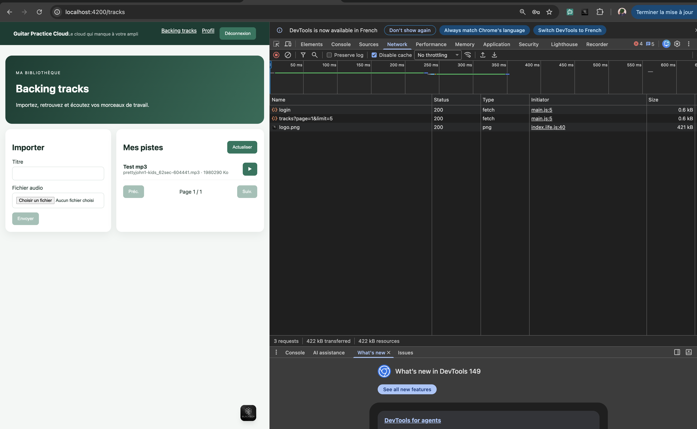

- Erreur 401 et message d'erreur :  
  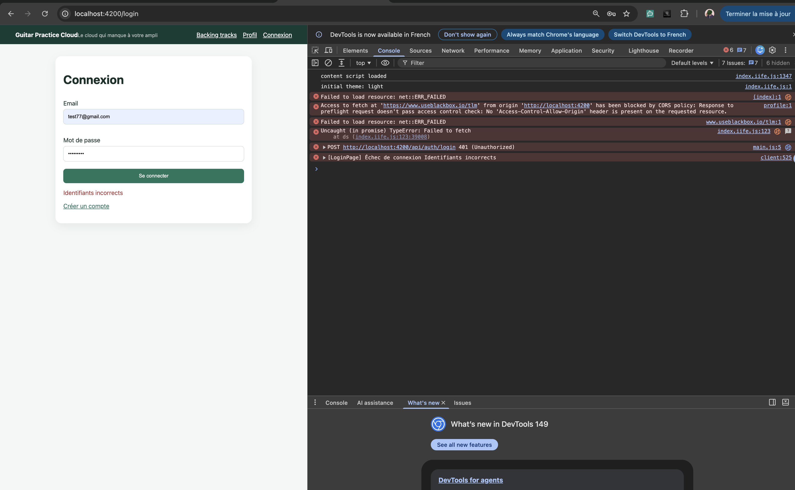

#### 8. Ce que je sais expliquer sans l'agent
- **Différence Signal vs localStorage :** Le `localStorage` est une API synchrone de persistance sur disque (le token y survit à la fermeture de l'onglet), mais il n'est pas réactif. Le `Signal` est un état réactif en mémoire vive qui notifie les composants dès qu'il change pour recalculer le DOM.
- **Trajet de la mise à jour du profil :** `profile-page.ts` appelle `AuthService.update()`, émettant un `PUT /api/users/me`. L'intercepteur injecte le JWT. Côté Express, le middleware extrait l'ID utilisateur, `User.findByIdAndUpdate()` persiste les données dans MongoDB Atlas, et la réponse synchronise le Signal `currentUser` côté client.

---

## TP2 — Bibliothèque, Upload et Lecture Audiov

### Mission 2 — Bibliothèque paginée serveur

#### 1. Objectif
Relier la bibliothèque au backend via `GET /api/tracks?page=X&limit=5`, orchestrer l'état avec des Signals (`tracks`, `page`, `pages`, `loading`, `listError`), gérer les boutons de navigation bornés et structurer l'affichage avec `@for`, `@empty` et `@if`.

#### 2. Prompt principal
> « Dans tracks-page.ts et track.service.ts, mettons en place la pagination serveur avec l'API GET /api/tracks?page=X&limit=5. Implémente l'état réactif avec des Signals Angular (tracks, page, pages, loading, error), les boutons précédent/suivant désactivés aux bornes, et l'affichage avec la syntaxe moderne @for, @empty et @if. »

#### 3. Plan proposé par l'agent
1. Vérifier que `TrackService.list()` propage les paramètres `page` et `limit` dans la requête HTTP.
2. Initialiser les signaux d'état dans `TracksPageComponent` et charger la page initiale via `ngOnInit()`.
3. Désactiver les boutons de navigation aux bornes (`page <= 1` et `page >= pages`).
4. Exploiter le nouveau flux de contrôle déclaratif `@for` avec suivi de clé unique (`track.id`).

#### 4. Vérifications réalisées
- Inspection du panneau Réseau : confirmation qu'aucun découpage local n'est effectué et qu'un clic sur « Suiv. » ou « Préc. » déclenche bien une requête serveur avec le paramètre `page` mis à jour.
- Vérification du bon rendu de l'état vide (`@empty`) lorsqu'aucune piste n'est renvoyée.

#### 5. Erreurs ou propositions rejetées
- Proposition de charger les données dans le `constructor()` du composant : rejetée au profit du hook de cycle de vie standard `ngOnInit()`.

#### 6. Fichiers effectivement modifiés
- `frontend-starter/src/app/shared/services/track.service.ts`
- `frontend-starter/src/app/components/tracks-page/tracks-page.ts`
- `frontend-starter/src/app/components/tracks-page/tracks-page.html`
- `frontend-starter/src/app/components/tracks-page/tracks-page.css`

#### 7. Preuve de fonctionnement
- Échange avec l'IA sur la pagination :  
  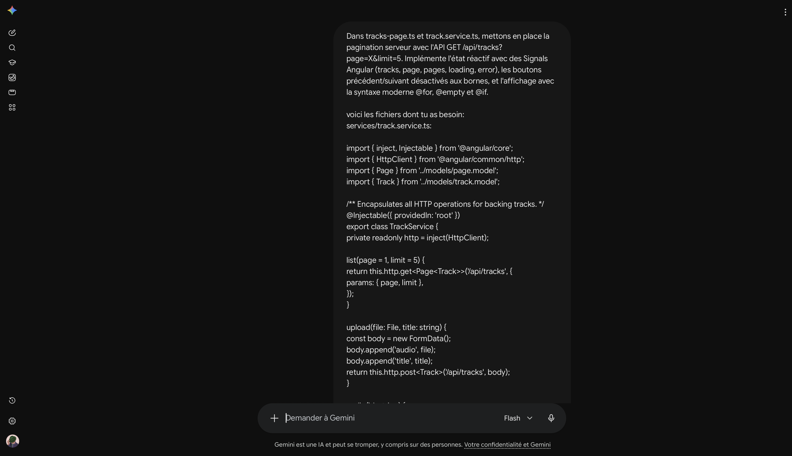
  
- Requête réseau paginée (`GET /api/tracks?page=...`) :  
  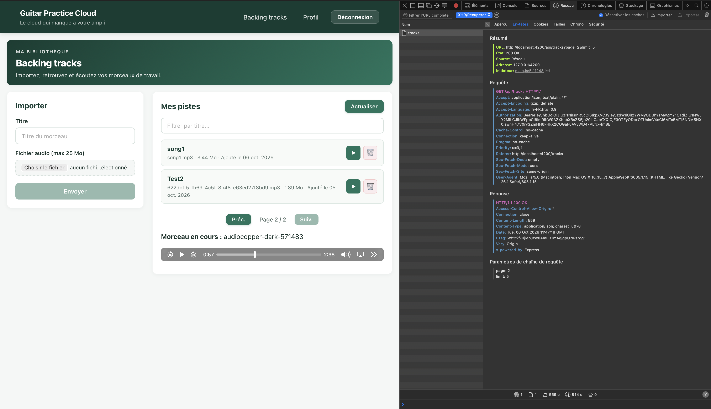

#### 8. Ce que je sais expliquer sans l'agent
- Pourquoi la pagination locale (découper un grand tableau dans Angular) est proscrite face à une volumétrie réelle : elle surchargerait la bande passante et la mémoire du navigateur dès que la base grandit, alors que la pagination serveur ne transfère que le strict nécessaire par page.

---

### Mission 3 — Upload validé et Lecture audio sécurisée

#### 1. Objectif
Valider les fichiers en amont côté client (< 25 Mo et format audio), gérer les états d'envoi et d'anti-double soumission, et implémenter la lecture audio authentifiée par `Blob` et `ObjectURL` avec révocation mémoire.

#### 2. Prompts principaux
- **Validation de l'upload :**
  > « Côté frontend dans tracks-page, ajoute la validation avant l'upload : vérifier que le fichier est bien un format audio et que sa taille est strictement inférieure à 25 Mo. Gère les états de soumission (loading, désactivation anti-double clic, message d'erreur serveur ou de succès) et la réinitialisation du formulaire avec rechargement de la page 1 après succès. »
- **Architecture de lecture audio :**
  > « Pour la lecture audio authentifiée, explique pourquoi un simple <audio src="/api/tracks/:id/audio"> ne fonctionne pas avec notre JWT. Montre comment récupérer le flux audio sous forme de Blob via HttpClient, créer un ObjectURL, l'assigner au lecteur, et surtout révoquer l'ancienne URL avec URL.revokeObjectURL pour éviter les fuites mémoire. »

#### 3. Plan proposé par l'agent
1. **Validation préventive synchrone :** Vérification du type MIME et de la taille maximale en octets ($25 \times 1024 \times 1024$) avant l'envoi HTTP.
2. **Gestion de l'upload :** Désactivation du bouton d'envoi pendant le téléversement, affichage de messages d'état, suivi de la progression et réinitialisation du champ fichier après succès.
3. **Architecture audio :** Requête via `HttpClient` avec `responseType: 'blob'`, création de l'`ObjectURL` locale et révocation systématique de l'ancienne URL via `URL.revokeObjectURL` lors du changement de piste et dans `ngOnDestroy`.
4. **Améliorations facultatives intégrées :** Barre de progression d'upload, suppression de piste avec confirmation (`DELETE /api/tracks/:id`), filtrage dynamique par titre et formatage des dates.

#### 4. Vérifications réalisées
- Tentative d'import d'un fichier invalide ou trop lourd : blocage direct dans l'interface sans envoi de requête HTTP inutile.
- Téléversement d'un fichier audio valide : affichage de la progression, requête multipart `POST /api/tracks` (statut 200/201), puis retour à la page 1 avec actualisation.
- Lecture audio : confirmation de l'injection du header `Authorization: Bearer <token>` sur la requête `GET /api/tracks/:id/audio` et vérification que le lecteur joue le flux sans fuite mémoire.

#### 5. Erreurs ou propositions rejetées
- L'agent n'avait initialement prévu qu'un `console.error` en cas d'erreur de lecture : rejeté et remplacé par une notification visible dans le Signal d'erreur de l'interface.
- Rejet de l'utilisation directe de l'URL d'API dans l'attribut `src` de la balise `<audio>`, cette approche ne permettant pas de transmettre le header Bearer.

#### 6. Fichiers effectivement modifiés / créés
- `frontend-starter/src/app/shared/services/track.service.ts`
- `frontend-starter/src/app/components/tracks-page/tracks-page.ts`
- `frontend-starter/src/app/components/tracks-page/tracks-page.html`
- `livrables/TP2/REPONSES_QUESTIONS_TP2.md`

#### 7. Preuve de fonctionnement
- Échanges avec l'IA sur l'upload et le lecteur audio :  
  
    
  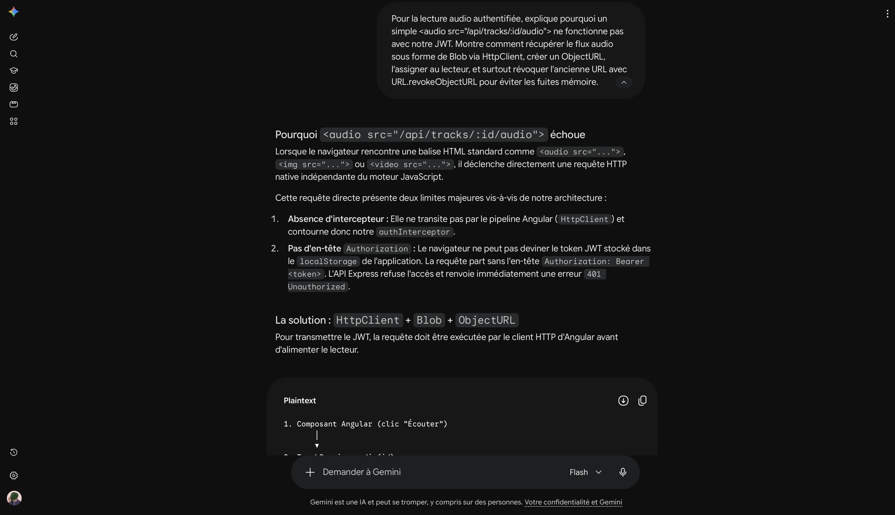
- Preuves DevTools :  
    
  

#### 8. Ce que je sais expliquer sans l'agent
- **Pourquoi `<audio src="...">` échoue sans Blob :** Les balises multimédias natives exécutent des requêtes hors du contexte de l'application et n'ont pas accès au token JWT présent dans le `localStorage`. Elles ne transitent pas par l'intercepteur Angular et reçoivent un statut 401.
- **Rôle du Garbage Collector et révocation :** `URL.createObjectURL()` crée une référence mémoire forte vers le flux binaire. Le Garbage Collector ne peut pas détruire le `Blob` tant que cette URL existe. `URL.revokeObjectURL()` libère immédiatement l'espace RAM alloué.
- **Validation client vs serveur :** La validation frontend offre un retour d'expérience immédiat à l'utilisateur, mais elle est contournable (via cURL, Postman ou la console) : la validation backend reste l'unique garant de l'intégrité et de la sécurité du système.

---

## TP3 — Fiabilisation et enrichissement du frontend

### Mission 5 — Suppression d’une piste et gestion des conflits

#### 1. Objectif
Ajouter une action de suppression sécurisée sur chaque card de piste via `DELETE /api/tracks/:id`, sécuriser l'opération avec une boîte de confirmation utilisateur, mettre en place un état de suppression pour verrouiller l'interface contre les doubles clics, notifier l'utilisateur par un composant SnackBar éphémère, réajuster dynamiquement la pagination en cas de suppression du dernier élément d'une page, et traiter spécifiquement les cas d'erreur de concurrence `404` (ressource déjà supprimée dans un autre onglet) et `403` (ressource n'appartenant pas à l'utilisateur connecté).

#### 2. Prompt principal
> « Dans track.service.ts et tracks-page, implémente la suppression d'une piste via DELETE /api/tracks/:id. Ajoute une confirmation avant suppression, un état de suppression pour bloquer les doubles clics, un message de retour (succès ou erreur), le rafraîchissement automatique de la liste (en gérant le cas de la dernière piste d'une page), et le traitement des erreurs si la piste a déjà été supprimée (404) ou n'appartient pas à l'utilisateur (403). Explique pourquoi le guard et l'interface ne suffisent pas à sécuriser cette action. »

#### 3. Plan proposé par l'agent
1. **`track.service.ts` :** Créer la méthode `delete(id: string): Observable<void>` utilisant `HttpClient.delete`.
2. **`tracks-page.ts` :**
   - Introduire le signal `deletingId = signal<string | null>(null)` pour verrouiller spécifiquement le bouton de la piste en cours de suppression.
   - Ajouter le signal `snackbarMessage` pour afficher un bandeau éphémère (durée 4 secondes).
   - Arrêter la lecture audio et révoquer l'URL locale si la piste supprimée correspondait à la piste en cours d'écoute.
   - Gérer le recul de page automatique (`this.tracks().length === 1 && this.page() > 1`) avant de recharger la liste.
   - Traiter les statuts `HttpErrorResponse` : réactualiser l'affichage sur statut `404` et alerter sur statut `403`.
3. **`tracks-page.html` & `tracks-page.css` :** Ajouter l'élément `<aside class="snackbar">` et relier le bouton corbeille avec `[disabled]="deletingId() === track.id"` sans injecter de styles en ligne.

#### 4. Vérifications réalisées
- Déclenchement de la suppression avec confirmation native : vérification de la désactivation du bouton (affichage de `…` à la place de l'icône de corbeille).
- Observation de l'onglet Network : requête `DELETE /api/tracks/:id` émise avec statut 204 No Content, disparition immédiate de la carte et affichage de la SnackBar de succès.
- Test de suppression de l'unique élément de la page 2 : l'application décrémente automatiquement le signal `page` à 1 et recharge les éléments correspondants.

#### 5. Erreurs ou propositions rejetées
- Proposition de l'agent d'ajouter un composant de dialogue lourd issu d'une bibliothèque externe : rejetée pour conserver la boîte modale native du navigateur (`window.confirm`) et un composant SnackBar léger piloté par Signals.
- Utilisation initiale de styles en ligne (`style="..."`) dans le template : rejetée et intégralement déportée dans des classes CSS (`.snackbar`, `.snackbar-success`, `.snackbar-error`).

#### 6. Fichiers effectivement modifiés
- `frontend-starter/src/app/shared/services/track.service.ts`
- `frontend-starter/src/app/components/tracks-page/tracks-page.ts`
- `frontend-starter/src/app/components/tracks-page/tracks-page.html`
- `frontend-starter/src/app/components/tracks-page/tracks-page.css`

#### 7. Preuves de fonctionnement
- Échange avec l'IA sur la suppression et la concurrence :  
  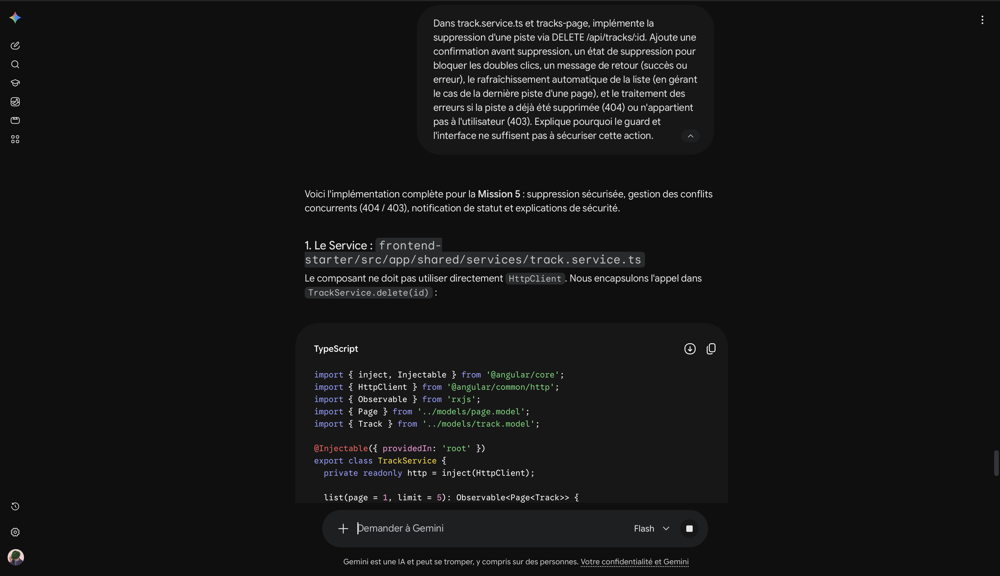
- Trace réseau de la suppression confirmée (`DELETE /api/tracks/:id`) :  
  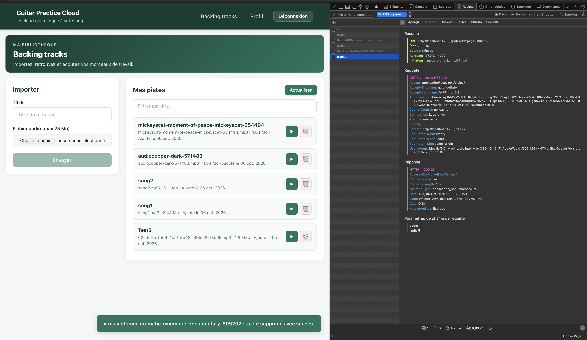

#### 8. Ce que je sais expliquer sans l'agent
- **Pourquoi la suppression passe par un service (SOC) :** Le composant ne doit pas connaître les détails d'implémentation HTTP (URL, headers, verbes). Il délègue l'opération à `TrackService.delete()`, ce qui évite la duplication de code et permet de tester le composant isolément en bouchonnant le service.
- **Pourquoi le guard et l'interface ne protègent pas la suppression :** Le code client et le DOM sont entièrement modifiables depuis la console du navigateur ou via des requêtes directes (cURL / Postman). Seul le backend Express sécurise la suppression en vérifiant la signature du JWT via `authMiddleware` et en validant dans MongoDB que `track.userId.toString() === req.user.id.toString()`. En cas de violation, le backend répond avec un statut `403 Forbidden`.

---

### Mission 6 — Événements HTTP et Progression de l’upload

#### 1. Objectif
Faire évoluer le mécanisme de téléversement pour écouter les événements réseau en temps réel via l'API d'Angular (`reportProgress: true` et `observe: 'events'`), calculer dynamiquement le pourcentage d'avancement, piloter les états réactifs (inactif, en cours, succès, échec), et verrouiller les formulaires pendant le transfert pour prévenir toute double soumission.

#### 2. Prompt principal
> « Fais évoluer la méthode d'upload dans track.service.ts et tracks-page pour gérer la progression via les événements HTTP Angular (reportProgress: true, observe: 'events'). Gère les états réactifs : inactif, en cours avec pourcentage calculé dynamiquement, succès et échec. Désactive les contrôles pendant l'envoi pour éviter toute double soumission. Explique pourquoi cette approche diffère d'une requête HTTP standard à réponse unique. »

#### 3. Plan proposé par l'agent
1. **`track.service.ts` :** Implémenter `uploadWithProgress(file: File, title: string): Observable<HttpEvent<Track>>` en ajoutant les options `{ reportProgress: true, observe: 'events' }` à l'appel `HttpClient.post`.
2. **`tracks-page.ts` :**
   - Écouter le flux d'événements dans le callback `next` : identifier `HttpEventType.UploadProgress` pour calculer le pourcentage via `Math.round((event.loaded * 100) / event.total)` et l'affecter au signal `uploadProgress`.
   - Intercepter l'événement final `HttpEventType.Response` pour marquer le succès, afficher le message, purger le formulaire et recharger la liste depuis la première page.
   - Gérer le bloc `error` pour réinitialiser la progression et afficher l'erreur serveur.
3. **`tracks-page.html` :** Désactiver les champs de formulaire et le bouton d'envoi lorsque le signal `uploading()` est actif, et afficher la balise `<progress>` synchronisée.

#### 4. Vérifications réalisées
- Simulation de limitation de bande passante réseau (Network Throttling dans les DevTools) : observation de l'incrémentation fluide de la barre de progression et du libellé de pourcentage dans l'interface pendant l'envoi.
- Vérification du verrouillage des contrôles : impossibilité de re-sélectionner un fichier ou de soumettre à nouveau le formulaire tant que le transfert n'est pas terminé.
- Vérification de l'absence de toute donnée sensible (mot de passe ou token JWT) dans l'interface ou dans les journaux de la console du navigateur.

#### 5. Erreurs ou propositions rejetées
- Proposition de l'agent d'utiliser un calcul de progression simulé via un `setInterval` artificiel : rejetée au profit des événements réels transmis par le socket réseau via `HttpEventType.UploadProgress`.

#### 6. Fichiers effectivement modifiés
- `frontend-starter/src/app/shared/services/track.service.ts`
- `frontend-starter/src/app/components/tracks-page/tracks-page.ts`
- `frontend-starter/src/app/components/tracks-page/tracks-page.html`
- `frontend-starter/src/app/components/tracks-page/tracks-page.css`

#### 7. Preuves de fonctionnement
- Échange avec l'IA sur les événements HTTP et le calcul de progression :  
  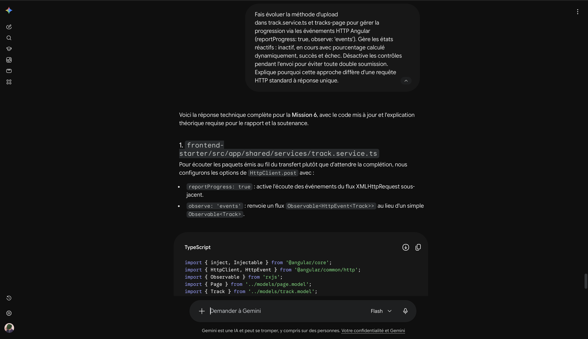
- Affichage de la barre de progression active et requête réseau en cours :  
  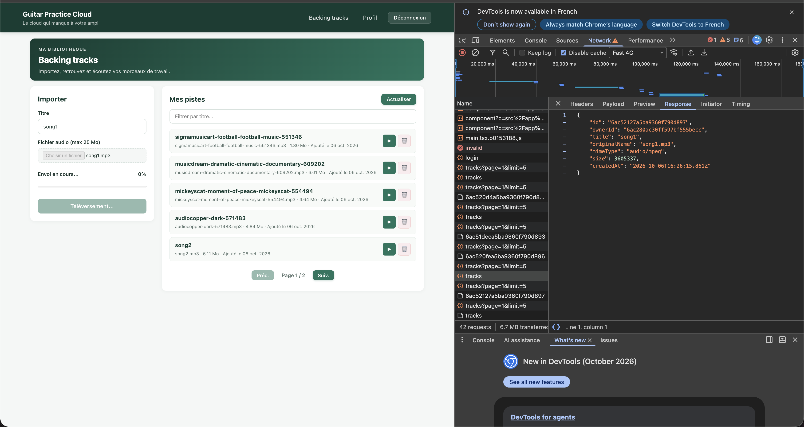

#### 8. Ce que je sais expliquer sans l'agent
- **Différence avec une requête HTTP standard :** Une requête standard produit un Observable qui n'émet qu'une seule valeur scalaire finale (le corps désérialisé) au moment où la réponse serveur est reçue. Avec `reportProgress: true` et `observe: 'events'`, l'Observable devient un flux d'événements continus qui émet successivement `Sent`, une série d'événements intermédiaires `UploadProgress` rythmés par le départ des paquets TCP, puis enfin `Response`.
- **Calcul du pourcentage :** Les métadonnées binaires `event.loaded` (octets émis) et `event.total` (taille totale) fournies par l'API XMLHttpRequest permettent d'appliquer la formule arithmétique de progression en temps réel sans approximation.

---

### Mission 7 — Tests unitaires automatisés

#### 1. Objectif
Mettre en place une suite de tests unitaires frontend automatisés, déterministes et isolés du backend Express et de MongoDB Atlas, en utilisant `TestBed`, `HttpTestingController` et l'environnement moderne Vitest / jsdom d'Angular. Tester la transmission des paramètres de pagination, l'exécution de la suppression HTTP, et l'injection conditionnelle du JWT par l'intercepteur.

#### 2. Prompt principal
> « Écris les 3 tests unitaires complets et isolés avec Jasmine et HttpTestingController (sans dépendre du backend réel) :
> 1. TrackService.list() transmettant correctement les paramètres page et limit ;
> 2. authInterceptor injectant l'en-tête Authorization: Bearer <token> lorsqu'un token existe ;
> 3. TrackService.delete() exécutant bien la méthode DELETE /api/tracks/:id. »

#### 3. Plan proposé par l'agent
1. Configurer l'environnement de test dans `angular.json` en ajoutant la cible `gpc:build:development` requise par le test runner moderne d'Angular.
2. Installer `jsdom` en dépendance de développement pour exécuter les tests dans un environnement DOM virtuel sans navigateur lourd.
3. Écrire `track.service.spec.ts` : tester `list(2, 5)` avec vérification des query params et de la méthode `GET`, puis tester `delete(id)` avec vérification de l'URL et de la méthode `DELETE`.
4. Écrire `auth.interceptor.spec.ts` : tester l'injection du header `Authorization` avec un token présent dans le signal `AuthService.token()`, et vérifier son omission lorsque le signal vaut `null`.

#### 4. Vérifications réalisées
- Résolution des erreurs d'environnement (`Invalid Chai property: toBeTrue`) dues au runner moderne Vitest en remplaçant la syntaxe Jasmine spécifique par les assertions standards `toBe(true)` et `toBe(false)`.
- Exécution de la commande `npm test -- --watch=false` : 4 tests exécutés avec succès (4/4 au vert) en moins d'une seconde.
- Exécution de `npm run build` : validation de la compilation de production sans erreur de typage ni d'assemblage.

#### 5. Erreurs ou propositions rejetées
- L'agent avait initialement rédigé les assertions avec `toBeTrue()` et `toBeFalse()` (syntaxe Jasmine pure), ce qui provoquait l'échec des tests sous l'environnement Vitest / Chai du projet : correction immédiate avec `toBe(true)` et `toBe(false)`.

#### 6. Fichiers créés / modifiés
- `frontend-starter/angular.json`
- `frontend-starter/src/app/shared/services/track.service.spec.ts`
- `frontend-starter/src/app/shared/interceptors/auth.interceptor.spec.ts`
- `livrables/TP3/RAPPORT_TESTS.html`

#### 7. Preuves de fonctionnement
- Échange avec l'IA sur l'écriture et la correction des tests unitaires :  
  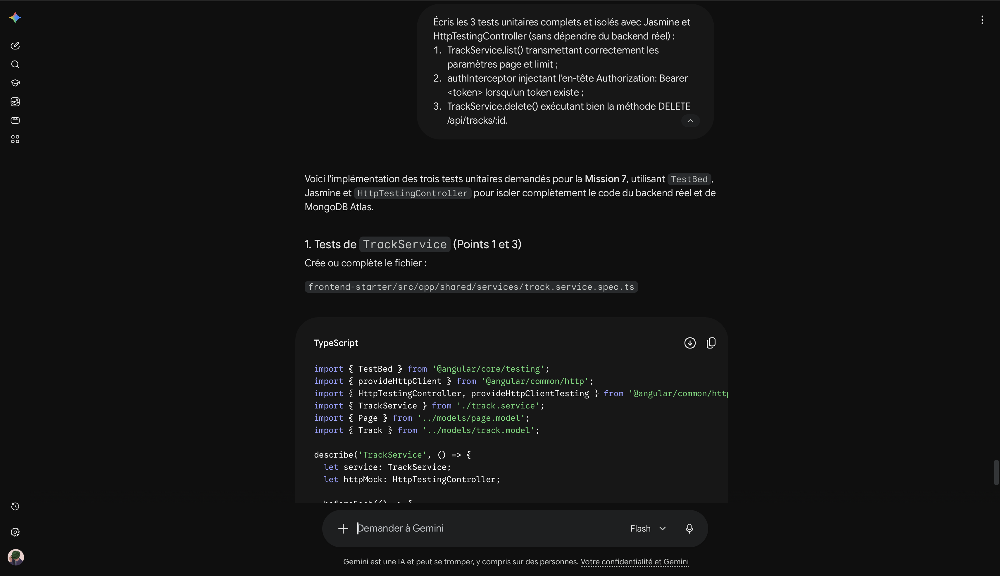
- Terminal confirmant le succès des 4 tests unitaires :  
  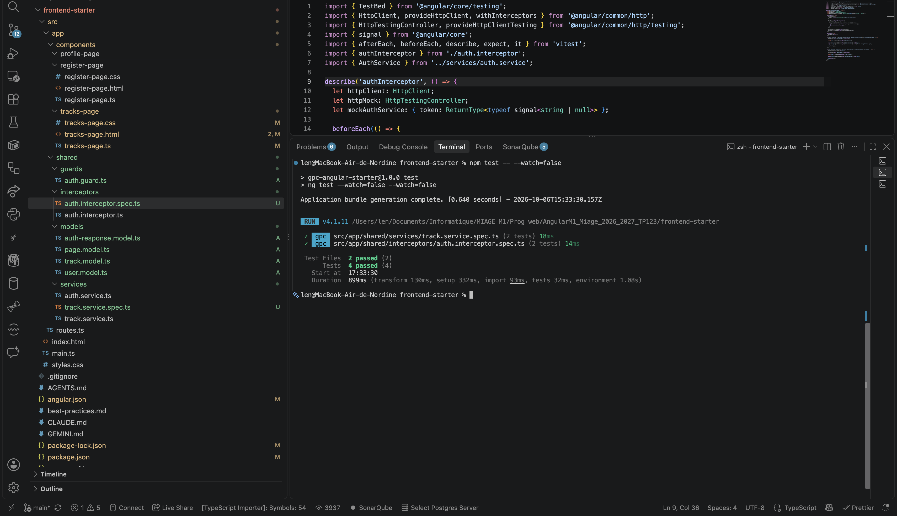
- Terminal confirmant le succès de la commande `npm run build` :  
  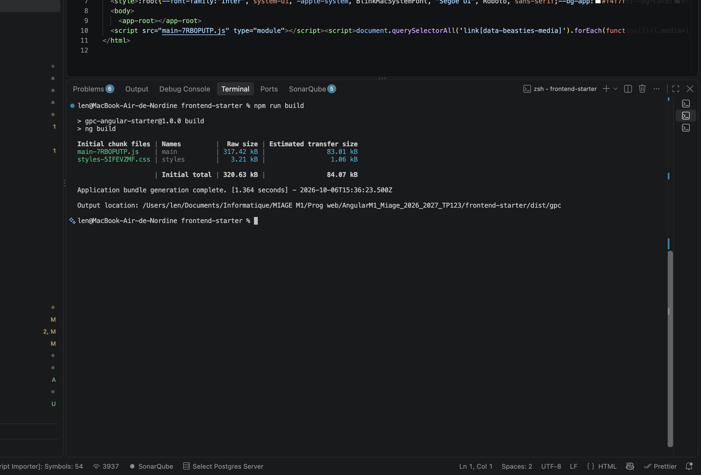

#### 8. Ce que je sais expliquer sans l'agent
- **Pourquoi les tests HTTP n'ont pas besoin de MongoDB :** Un test unitaire teste la logique interne d'une brique logicielle Angular en isolation stricte. `HttpTestingController` intercepte les requêtes en mémoire avant leur émission réseau et injecte des réponses simulées (`req.flush()`). Cela garantit une suite de tests rapide, reproductible et indépendante de l'état de la base de données.
- **Différence entre test unitaire et test d'intégration :** Le test unitaire valide une unité de code isolée en simulant l'ensemble de ses dépendances. Le test d'intégration valide la collaboration effective entre plusieurs briques interconnectées (par exemple composant, service, intercepteur et routage) pour s'assurer de la cohérence globale des flux de données.

---

# Phase 2 : Projet en Autonomie (TP4 / TP5 / TP6) - VibeSpot

**Périmètre traité :** Personne B -> *Réseau social, contrôle d'accès granulaire (ACL), partage de lieux et listes collaboratives* (en binôme avec Personne A sur le domaine *Spots & Cartographie*).

## Mission 1.1 — Architecture Backend Social, Partage Sécurisé & Listes Collaboratives

### 1. Objectif
Faire évoluer le socle backend Express/Mongoose vers l'application **VibeSpot** en implémentant la gestion complète des relations d'amitié, le contrôle d'accès granulaire sur les lieux (`PUBLIC`, `FRIENDS`, `PRIVATE` avec liste `sharedWith`), la révocation d'accès en un clic ou en cascade lors du retrait d'un ami, le fil d'activité social (`/api/feed`) et les listes collaboratives réordonnables.

### 2. Prompt principal
> « Lis backend/best-practices.md et API_CONTRACT.md. Pour le périmètre Personne B (Social, Partage & Listes) de VibeSpot, analyse et implémente les évolutions backend suivantes en conservant la compatibilité avec la base MongoDB partagée et le middleware JWT (req.auth.sub) :
> 1. Modèles Mongoose : étendre User.js (friends, friendRequests), Spot.js (visibility, sharedWith) et CustomList.js (collaborators).
> 2. Routes Amis & Révocation en cascade : recherche d'utilisateurs avec statut relationnel, envoi/acceptation/refus d'invitations, suppression d'ami avec purge automatique de sharedWith et collaborators.
> 3. Contrôle d'accès (ACL) & Fil d'activité : route PATCH /api/spots/:id/share pour gérer ou stopper le partage, sécurisation des routes GET /api/spots et GET /api/spots/:id (renvoi 403 Forbidden si privé non autorisé), et route GET /api/feed.
> 4. Extensions Listes Collaboratives : ajout de PUT /api/lists/:id et PUT /api/lists/:id/reorder pour le Drag & Drop. »

### 3. Plan proposé par l'agent
1. **Évolution des schémas Mongoose :** Ajout de `friends` et `friendRequests` dans `User.js`, de `visibility` (`default: "PUBLIC"`) et `sharedWith` dans `Spot.js`, et de `collaborators` dans `CustomList.js`.
2. **Helpers de sécurité ACL :** Création de `buildSpotAccessFilter()` pour filtrer les requêtes MongoDB selon l'identité du demandeur (`optionalAuth`) et de `canAccessSpot()` pour bloquer l'accès direct aux spots privés non partagés (`403 Forbidden`).
3. **Endpoints d'amitié et purge en cascade :** Implémentation de `/api/users/search`, `/api/friends`, `/api/friends/request/:userId`, `/api/friends/respond/:requestId` et `DELETE /api/friends/:friendId` exécutant en parallèle le retrait symétrique d'amitié et la purge de `Spot.sharedWith` et `CustomList.collaborators`.
4. **Partage granulaire & Fil social :** Ajout de `PATCH /api/spots/:id/share` (réservé au propriétaire `spot.createdBy === req.auth.sub`) et de `GET /api/feed` agrégeant les créations de spots, avis et listes des amis.

### 4. Vérifications réalisées
- Synchronisation de la branche de travail (`devnoureddine`) avec `main` pour récupérer les modèles de base `Spot.js` et `CustomList.js`.
- Démarrage conjoint du serveur Express et du client Angular sans erreur de syntaxe ni de connexion à la base MongoDB Atlas partagée.
- Vérification de la rétrocompatibilité des spots existants grâce à la valeur par défaut `"PUBLIC"` sur le champ `visibility`.

### 5. Erreurs, interrogations et arbitrages techniques
- **Interrogation sur la base MongoDB partagée :** Comment ne pas casser l'affichage de Personne A sur les spots déjà créés en base ? Arbitrage : inclusion systématique de `{ visibility: { $exists: false } }` dans `buildSpotAccessFilter()`.
- **Collision d'opérateurs MongoDB `$or` :** La route `GET /api/spots` utilisait déjà `filter.$or` pour la recherche textuelle (`?search=`). Pour éviter que le filtre ACL n'écrase la recherche, les deux conditions ont été encapsulées dans un tableau `filter.$and`.
- **Harmonisation du payload JWT :** Utilisation stricte de `req.auth.sub` (et non `req.user.id`) et validation systématique des paramètres via `mongoose.isValidObjectId()`.

### 6. Fichiers effectivement modifiés
- `backend/src/models/User.js`
- `backend/src/models/Spot.js`
- `backend/src/models/CustomList.js`
- `backend/src/app.js`
- `API_CONTRACT.md`

### 7. Preuve de fonctionnement
*(À compléter lors des tests DevTools en M1.2 / M3 : capture d'écran de l'onglet Network montrant la révocation d'accès `PATCH /api/spots/:id/share` et le refus `403 Forbidden` côté utilisateur révoqué).*

### 8. Ce que je sais expliquer sans l'agent
- **Pourquoi le filtrage ACL doit être fait dans la requête MongoDB (`buildSpotAccessFilter`) et pas en JavaScript après coup :** Filtrer en mémoire casserait la pagination serveur (`page`, `limit`, `total`) car `countDocuments()` renverrait un total incluant des spots privés invisibles pour l'utilisateur.
- **Intégrité référentielle lors de la suppression d'un ami :** Retirer un utilisateur de `User.friends` ne suffit pas ; il faut purger simultanément `Spot.sharedWith` et `CustomList.collaborators` pour éviter qu'un ancien ami conserve un accès résiduel à des contenus privés.