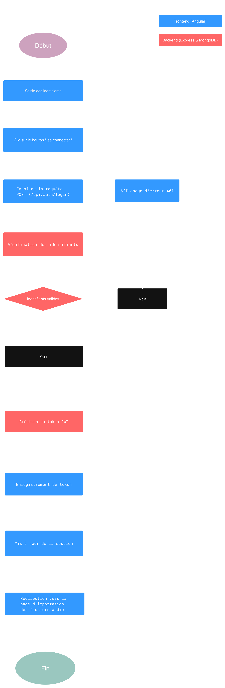
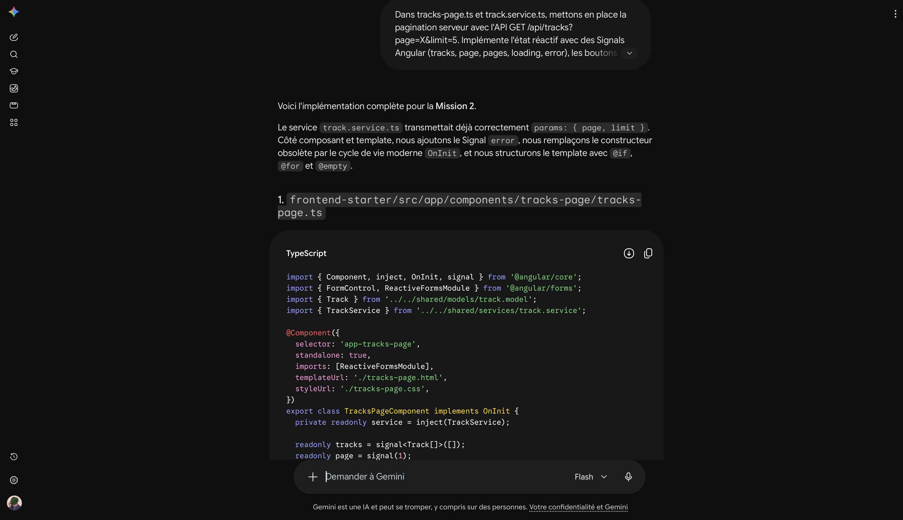
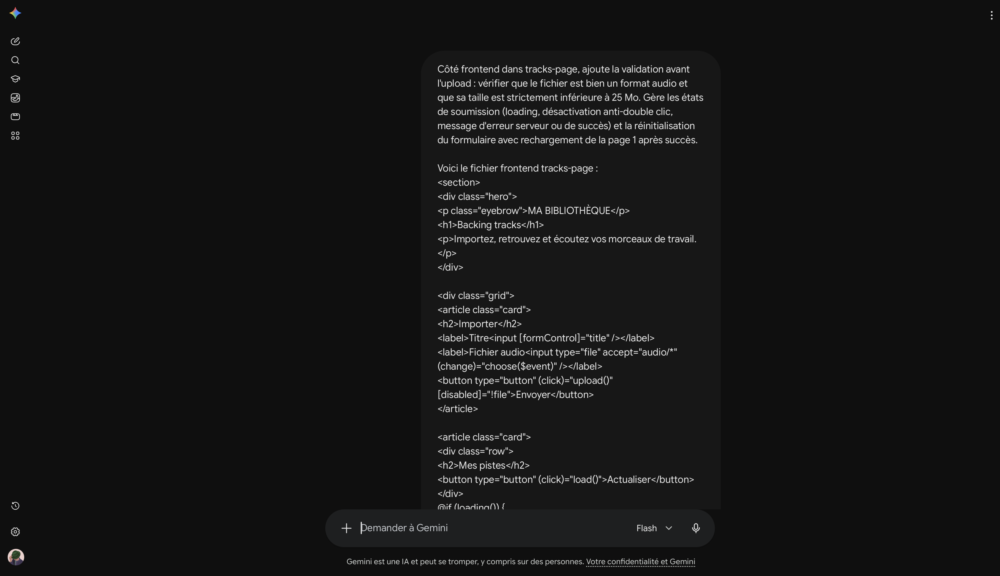
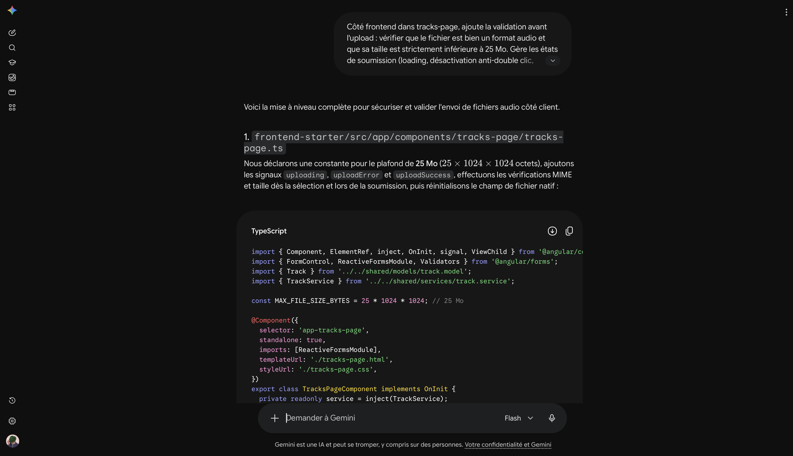
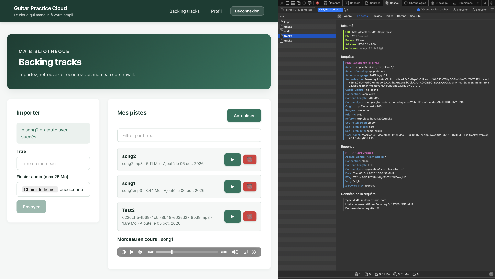

# Rapport d'usage de l'IA — TP1 et TP2

## Informations générales
- **Étudiant :** Nordine (travail individuel)
- **Modèles d'IA utilisés :** Cursor Agent / Claude 3.5 Sonnet (assisté par Gemini pour l'environnement et l'architecture réactive)
- **Mesure de la consommation de tokens :** Suivi effectué via l'interface de l'éditeur (panneau des statistiques d'usage et compteurs de contexte).
- **Critères de sélection du modèle :** Utilisation d'un modèle orienté ingénierie logicielle pour la rigueur sur l'architecture Angular moderne (standalone, inject, Signals, flux `@for`/`@if`) et la sécurité Web (JWT, Streams, Blob).

---

## TP1 — Authentification et Profil utilisateur

### Mission 0 — Cartographie et Flux d'authentification

#### 1. Objectif
Identifier l'architecture applicative sans modifier le code : repérer le composant racine, les routes, l'injection de `HttpClient`, la distinction entre routes publiques et protégées (`API_CONTRACT.md`), et formaliser le schéma du flux de connexion.

#### 2. Prompt principal
> « Analyse l'arborescence et le code existant du projet Guitar Practice Cloud. Identifie le composant racine, le fichier de routage, la configuration du client HTTP et le rôle de l'intercepteur. Produis les étapes du flux de connexion complet lors du clic sur "Se connecter", depuis le composant Angular jusqu'à MongoDB via Express. »

#### 3. Plan proposé par l'agent
1. Cartographier le composant racine (`src/app/components/app/app.ts`), le bootstrap (`src/main.ts`) et la configuration des routes (`src/app/routes.ts`).
2. Vérifier l'injection globale de `provideHttpClient(withInterceptors([authInterceptor]))`.
3. Tracer le flux d'authentification : Clic UI → `login-page.ts` → `AuthService.login()` → appel HTTP POST via Proxy → route Express `/api/auth/login` → vérification du mot de passe haché dans `User.js` via bcrypt → génération du token JWT → retour client.
4. Structurer les étapes logiques pour tracer le diagramme de flux complet.

#### 4. Vérifications réalisées
- Vérification visuelle des correspondances de ports dans `proxy.conf.json` (`/api` redirigé vers `http://localhost:3000`).
- Réalisation du diagramme de flux sous draw.io représentant le cycle de vie de la requête et la séparation claire client / serveur.

#### 5. Erreurs ou propositions rejetées
- Proposition de l'agent d'utiliser l'ancienne configuration par module (`NgModule` et `HTTP_INTERCEPTORS`). Rejetée pour rester sur les composants Standalone et `HttpInterceptorFn`.

#### 6. Fichiers effectivement inspectés / modifiés
- `frontend-starter/src/main.ts`
- `frontend-starter/src/app/routes.ts`
- `frontend-starter/proxy.conf.json`
- `backend/src/app.js`
- `livrables/TP1/schema_diagramme_flux_process.drawio.png`

#### 7. Preuve de fonctionnement

#### 8. Ce que je sais expliquer sans l'agent
- Pourquoi Angular ne dialogue jamais directement avec MongoDB : la base requiert des identifiants secrets et une connexion réseau directe impossible depuis le navigateur ; l'API Express sert de barrière de validation et de sécurité.
- Le rôle d'aiguillage du proxy de développement (`proxy.conf.json`) pour éviter les blocages CORS entre le port 4200 (Angular) et le port 3000 (API Express).

---

### Mission 1 — Inscription, Connexion et Profil

#### 1. Objectif
Implémenter la gestion de session utilisateur réactive et sécurisée avec Angular Signals, formulaires réactifs avec validation, synchronisation `localStorage`, gestion des retours 401 et mise à jour du profil via `PUT /api/users/me`.

#### 2. Prompt principal
> « Avec le même procédé d'analyse du code existant, effectue les tâches suivantes avec la dernière syntaxe d'Angular +18 : 
> - le stockage sécurisé du JWT côté navigateur sans l'afficher dans les logs ;
> - la mise à jour du Signal currentUser ;
> - la redirection après connexion ou inscription ;
> - la déconnexion avec nettoyage du token et de l'état utilisateur ;
> - le chargement du profil avec GET /api/users/me ;
> - la modification du nom avec PUT /api/users/me ;
> - la gestion d'une réponse 401 avec retour vers /login ;
> - l'utilisation de inject() sans constructeurs obsolètes ;
> - le respect de la séparation composant, service et API. »

#### 3. Plan proposé par l'agent
1. **`auth.service.ts` :** Implémentation des Signals `token` (initialisé via `localStorage`) et `currentUser`. Exposition des méthodes `login()`, `register()`, `profile()`, `update()` et `logout()`.
2. **`auth.interceptor.ts` :** Ajout de l'en-tête `Authorization: Bearer <token>` sur les requêtes sortantes et écoute des erreurs via `catchError` : redirection vers `/login` et appel à `logout()` en cas de code 401.
3. **`app.html` & `app.ts` :** Rendre la barre de navigation réactive : affichage conditionnel (`@if`) du bouton « Déconnexion » si l'utilisateur est authentifié.
4. **`profile-page` :** Chargement automatique des données du profil à l'initialisation et mise à jour réactive du nom.
5. **`login-page` & `register-page` :** Validation stricte des formulaires réactifs avec blocage des envois si invalides.

#### 4. Vérifications réalisées
- Test de tentative de connexion avec mot de passe erroné : réception du code HTTP 401 Unauthorized dans l'onglet Network et affichage immédiat de l'erreur dans l'UI sans recharger la page.
- Test de connexion réussie avec le compte de démo (`demo@example.com` / `Demo1234!`) : transition vers `/tracks`, persistance du token dans `localStorage` (clé `gpc_token`) et affichage du bouton « Déconnexion ».
- Test de déconnexion : vidage instantané du `localStorage`, réinitialisation des Signals et redirection vers l'écran de login.

#### 5. Erreurs ou propositions rejetées
- L'agent a suggéré l'usage d'un `constructor()` pour initialiser la session. Rejeté pour privilégier l'initialisation moderne d'Angular par `inject()` et initialisation directe de propriétés.
- Absence initiale de l'interception de l'erreur 401 dans `auth.interceptor.ts` : corrigée en ajoutant l'opérateur RxJS `catchError`.
- Proposition d'afficher les retours d'API avec `console.log()` : refusée pour éviter la fuite du token JWT dans la console DevTools.

#### 6. Fichiers effectivement modifiés
- `frontend-starter/src/app/shared/services/auth.service.ts`
- `frontend-starter/src/app/shared/interceptors/auth.interceptor.ts`
- `frontend-starter/src/app/components/app/app.ts`
- `frontend-starter/src/app/components/app/app.html`
- `frontend-starter/src/app/components/profile-page/profile-page.ts`
- `frontend-starter/src/app/components/profile-page/profile-page.html`
- `frontend-starter/src/app/components/login-page/login-page.ts`
- `frontend-starter/src/app/components/register-page/register-page.ts`
- `livrables/TP1/REPONSE_SIGNAL_LOCALSTORAGE.md`

#### 7. Preuve de fonctionnement
- Connexion réussie et statut 200 OK :  
  

- Erreur 401 et message d'erreur :  
  

#### 8. Ce que je sais expliquer sans l'agent
- **Différence Signal vs localStorage :** Le `localStorage` est une API synchrone de persistance sur disque (le token y survit à la fermeture de l'onglet), mais il n'est pas réactif. Le `Signal` est un état réactif en mémoire vive qui notifie les composants dès qu'il change pour recalculer le DOM.
- **Trajet de la mise à jour du profil :** `profile-page.ts` appelle `AuthService.update()`, émettant un `PUT /api/users/me`. L'intercepteur injecte le JWT. Côté Express, le middleware extrait l'ID utilisateur, `User.findByIdAndUpdate()` persiste les données dans MongoDB Atlas, et la réponse synchronise le Signal `currentUser` côté client.

---

## TP2 — Bibliothèque, Upload et Lecture Audio

### Mission 2 — Bibliothèque paginée serveur

#### 1. Objectif
Relier la bibliothèque au backend via `GET /api/tracks?page=X&limit=5`, orchestrer l'état avec des Signals (`tracks`, `page`, `pages`, `loading`, `listError`), gérer les boutons de navigation bornés et structurer l'affichage avec `@for`, `@empty` et `@if`.

#### 2. Prompt principal
> « Dans tracks-page.ts et track.service.ts, mettons en place la pagination serveur avec l'API GET /api/tracks?page=X&limit=5. Implémente l'état réactif avec des Signals Angular (tracks, page, pages, loading, error), les boutons précédent/suivant désactivés aux bornes, et l'affichage avec la syntaxe moderne @for, @empty et @if. »

#### 3. Plan proposé par l'agent
1. Vérifier que `TrackService.list()` propage les paramètres `page` et `limit` dans la requête HTTP.
2. Initialiser les signaux d'état dans `TracksPageComponent` et charger la page initiale via `ngOnInit()`.
3. Désactiver les boutons de navigation aux bornes (`page <= 1` et `page >= pages`).
4. Exploiter le nouveau flux de contrôle déclaratif `@for` avec suivi de clé unique (`track.id`).

#### 4. Vérifications réalisées
- Inspection du panneau Réseau : confirmation qu'aucun découpage local n'est effectué et qu'un clic sur « Suiv. » ou « Préc. » déclenche bien une requête serveur avec le paramètre `page` mis à jour.
- Vérification du bon rendu de l'état vide (`@empty`) lorsqu'aucune piste n'est renvoyée.

#### 5. Erreurs ou propositions rejetées
- Proposition de charger les données dans le `constructor()` du composant : rejetée au profit du hook de cycle de vie standard `ngOnInit()`.

#### 6. Fichiers effectivement modifiés
- `frontend-starter/src/app/shared/services/track.service.ts`
- `frontend-starter/src/app/components/tracks-page/tracks-page.ts`
- `frontend-starter/src/app/components/tracks-page/tracks-page.html`
- `frontend-starter/src/app/components/tracks-page/tracks-page.css`

#### 7. Preuve de fonctionnement
- Échange avec l'IA sur la pagination :  
  
  
- Requête réseau paginée (`GET /api/tracks?page=...`) :  
  

#### 8. Ce que je sais expliquer sans l'agent
- Pourquoi la pagination locale (découper un grand tableau dans Angular) est proscrite face à une volumétrie réelle : elle surchargerait la bande passante et la mémoire du navigateur dès que la base grandit, alors que la pagination serveur ne transfère que le strict nécessaire par page.

---

### Mission 3 — Upload validé et Lecture audio sécurisée

#### 1. Objectif
Valider les fichiers en amont côté client (< 25 Mo et format audio), gérer les états d'envoi et d'anti-double soumission, et implémenter la lecture audio authentifiée par `Blob` et `ObjectURL` avec révocation mémoire.

#### 2. Prompts principaux
- **Validation de l'upload :**
  > « Côté frontend dans tracks-page, ajoute la validation avant l'upload : vérifier que le fichier est bien un format audio et que sa taille est strictement inférieure à 25 Mo. Gère les états de soumission (loading, désactivation anti-double clic, message d'erreur serveur ou de succès) et la réinitialisation du formulaire avec rechargement de la page 1 après succès. »
- **Architecture de lecture audio :**
  > « Pour la lecture audio authentifiée, explique pourquoi un simple <audio src="/api/tracks/:id/audio"> ne fonctionne pas avec notre JWT. Montre comment récupérer le flux audio sous forme de Blob via HttpClient, créer un ObjectURL, l'assigner au lecteur, et surtout révoquer l'ancienne URL avec URL.revokeObjectURL pour éviter les fuites mémoire. »

#### 3. Plan proposé par l'agent
1. **Validation préventive synchrone :** Vérification du type MIME et de la taille maximale en octets ($25 \times 1024 \times 1024$) avant l'envoi HTTP.
2. **Gestion de l'upload :** Désactivation du bouton d'envoi pendant le téléversement, affichage de messages d'état, suivi de la progression et réinitialisation du champ fichier après succès.
3. **Architecture audio :** Requête via `HttpClient` avec `responseType: 'blob'`, création de l'`ObjectURL` locale et révocation systématique de l'ancienne URL via `URL.revokeObjectURL` lors du changement de piste et dans `ngOnDestroy`.
4. **Améliorations facultatives intégrées :** Barre de progression d'upload, suppression de piste avec confirmation (`DELETE /api/tracks/:id`), filtrage dynamique par titre et formatage des dates.

#### 4. Vérifications réalisées
- Tentative d'import d'un fichier invalide ou trop lourd : blocage direct dans l'interface sans envoi de requête HTTP inutile.
- Téléversement d'un fichier audio valide : affichage de la progression, requête multipart `POST /api/tracks` (statut 200/201), puis retour à la page 1 avec actualisation.
- Lecture audio : confirmation de l'injection du header `Authorization: Bearer <token>` sur la requête `GET /api/tracks/:id/audio` et vérification que le lecteur joue le flux sans fuite mémoire.

#### 5. Erreurs ou propositions rejetées
- L'agent n'avait initialement prévu qu'un `console.error` en cas d'erreur de lecture : rejeté et remplacé par une notification visible dans le Signal d'erreur de l'interface.
- Rejet de l'utilisation directe de l'URL d'API dans l'attribut `src` de la balise `<audio>`, cette approche ne permettant pas de transmettre le header Bearer.

#### 6. Fichiers effectivement modifiés / créés
- `frontend-starter/src/app/shared/services/track.service.ts`
- `frontend-starter/src/app/components/tracks-page/tracks-page.ts`
- `frontend-starter/src/app/components/tracks-page/tracks-page.html`
- `livrables/TP2/REPONSES_QUESTIONS_TP2.md`

#### 7. Preuve de fonctionnement
- Échanges avec l'IA sur l'upload et le lecteur audio :  
  
    
  
- Preuves DevTools :  
    
  

#### 8. Ce que je sais expliquer sans l'agent
- **Pourquoi `<audio src="...">` échoue sans Blob :** Les balises multimédias natives exécutent des requêtes hors du contexte de l'application et n'ont pas accès au token JWT présent dans le `localStorage`. Elles ne transitent pas par l'intercepteur Angular et reçoivent un statut 401.
- **Rôle du Garbage Collector et révocation :** `URL.createObjectURL()` crée une référence mémoire forte vers le flux binaire. Le Garbage Collector ne peut pas détruire le `Blob` tant que cette URL existe. `URL.revokeObjectURL()` libère immédiatement l'espace RAM alloué.
- **Validation client vs serveur :** La validation frontend offre un retour d'expérience immédiat à l'utilisateur, mais elle est contournable (via cURL, Postman ou la console) : la validation backend reste l'unique garant de l'intégrité et de la sécurité du système.