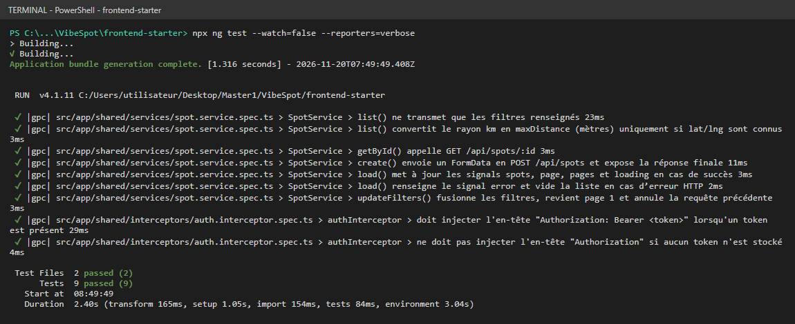

# Rapport d'usage de l'IA - TP4, TP5 et TP6 (VibeSpot)

## Informations générales
- **Projet :** VibeSpot, application de découverte de lieux selon l'humeur (Angular 22, Express, MongoDB Atlas).
- **Binôme :**
  - PISTONE Noa : partie A "Spots & Carte" (SpotService, explore-page avec la carte Leaflet, création de spot, fiche détaillée).
  - BRAHMIA Noureddine : partie B "Social, Partage & Listes" (routes amis et partage, SocialService, ListService, pages social / listes / profil).
  - En commun : REPORT.md, build final et relecture du rapport.
- **Organisation Git :** une branche chacun (`devnoa`, `devnoureddine`) qu'on met à jour à partir de `main`. On a découpé par fonctionnalité pour éviter de modifier les mêmes fichiers.
- **Modèle utilisé :** Claude Opus 5.5 avec Claude Code (extension VS Code), en mode agent.
- **Consommation de tokens :** suivie dans le panneau d'usage de Claude Code. *(à compléter)*
- **Pourquoi ce modèle :** il peut lire tout le dépôt (backend, frontend, API_CONTRACT.md) avant d'écrire du code, il respecte les consignes des fichiers CLAUDE.md et il peut lancer lui-même le build et les tests pour vérifier ce qu'il a fait.

---

## TP4 - Mission 1 : Socle frontend et SpotService (partie A - Noa)

### Prompt 1.1 - Analyse du backend avant de coder

#### 1. Objectif
Comprendre l'API Spots écrite par mon binôme et repérer tout ce qui reste de l'ancienne application audio dans le frontend, avant de modifier quoi que ce soit.

#### 2. Prompt principal
> « Avant toute modification, analyse le backend VibeSpot (`backend/src/app.js`, `backend/src/models/Spot.js`) et `API_CONTRACT.md`. Liste les routes `/api/spots*` avec leurs paramètres réels (`mood`, `category`, `budget`, `search`, `lat`, `lng`, `maxDistance` en mètres, `sort=popular|recent|rating`, `page`, `limit`), le format renvoyé par `toPublic()` et le format `Page<Spot>`. Repère dans `frontend-starter` ce qui relève de l'ancien domaine audio (`tracks-page`, `TrackService`, `Track`) et propose un plan de migration en petites étapes, sans encore écrire de code. »

#### 3. Plan proposé par l'agent
1. Lister les routes Spots : recherche paginée, carte, tendances, détail, création (multipart avec un seul champ `photo`), ajout de photo, favori, avis.
2. Décrire le format d'un Spot renvoyé par `toPublic()`.
3. Lister les fichiers audio à supprimer (`tracks-page`, `TrackService`, `Track`, route `/tracks`, redirection après login).
4. Ordre de travail : modèles TS, puis service, puis routes et nettoyage, puis tests.

#### 4. Vérifications réalisées
- J'ai comparé le code Express avec API_CONTRACT.md : ils correspondent, sauf pour la recherche par rayon (voir point 5).
- Recherche de `tracks` / `Track` dans `src/` : 10 fichiers concernés.

#### 5. Erreurs ou propositions rejetées
- Les humeurs du PDF d'architecture (Focus, Chill, Sport...) ne sont pas celles du backend (`travail`, `calme`, `festif`...). On a gardé celles du backend.
- Le PDF parle de `sort=trending` mais ça n'existe pas, il y a une route à part `/api/spots/trending`.
- Le PDF parle de Jasmine/Karma alors que le projet utilise Vitest depuis le TP3.
- L'agent a trouvé un bug dans le backend : avec `lat`/`lng`, la route utilise `$nearSphere` puis `countDocuments`, ce que MongoDB refuse, donc la recherche par rayon renvoie une erreur 500. Je ne l'ai pas corrigé car c'est la partie de mon binôme, je lui ai signalé (solution possible : `$geoWithin` avec `$centerSphere`).

#### 6. Fichiers inspectés
- `backend/src/app.js`, `backend/src/models/Spot.js`, `API_CONTRACT.md`
- `frontend-starter/src/main.ts`, `src/app/routes.ts`, `components/app/*`, `shared/services/track.service.ts`, `shared/interceptors/auth.interceptor.spec.ts`, `angular.json`

#### 7. Preuve de fonctionnement
Pas de capture pour cette étape car c'était seulement de l'analyse, aucun code n'a été modifié. Le résultat de l'analyse est résumé dans les points 3 et 5.

#### 8. Ce que je sais expliquer sans l'agent
- Si j'avais écrit les types à partir du PDF, les filtres auraient envoyé des valeurs que l'API ne connaît pas et on aurait eu des résultats vides sans aucune erreur.
- `$nearSphere` trie les résultats par distance, c'est pour ça qu'il est interdit dans un comptage. `$geoWithin` vérifie juste si un point est dans une zone, donc il marche avec `countDocuments`.

---

### Prompt 1.2 - Modèles TypeScript et SpotService

#### 1. Objectif
Typer les données Spot comme le backend les renvoie, et créer un service qui fait les appels HTTP et garde l'état de la recherche avec des Signals.

#### 2. Prompt principal
> « Crée `src/app/shared/models/spot.model.ts` avec des types stricts correspondant exactement au `toPublic()` du backend : `Spot`, `SpotPhoto`, `Review`, `SpotMarker`, les unions `Mood`, `Category`, `Budget = 1 | 2 | 3`, `Affluence`, et une interface `SpotFilters`. Puis crée `SpotService` avec `inject(HttpClient)` : un état réactif `signal<Spot[]>`, `filters = signal<SpotFilters>`, `loading`, `error`, `page`, `pages`, et des `computed()` dérivés (par exemple `hasResults`). Ajoute les méthodes `list(filters)`, `map(filters)`, `trending(limit)`, `getById(id)`, `create(formData)` et `addPhoto(id, file)`. Construis les query params avec `HttpParams` en n'envoyant que les filtres définis. N'utilise ni `any`, ni constructeur, ni `console.log`. »

#### 3. Plan proposé par l'agent
1. Dans `spot.model.ts`, déclarer les listes `MOODS` et `CATEGORIES` avec `as const` pour en déduire les types (on s'en resservira pour afficher les filtres).
2. Dans `SpotService`, des méthodes HTTP qui renvoient juste des Observables (`list`, `map`, `trending`, `getById`, `create`, `addPhoto`, `toggleFavorite`, `addReview`, `deleteReview`).
3. Des signals privés exposés en lecture seule, et des `computed()` : `hasResults`, `isEmpty`, `hasNextPage`, `hasPreviousPage`, `activeFiltersCount`.
4. Une méthode `load(page)` qui met à jour les signals et annule la requête précédente, et `updateFilters()` qui revient à la page 1.
5. Le rayon est saisi en km et converti en `maxDistance` (mètres) seulement si on a la position GPS.

#### 4. Vérifications réalisées
- `ng build` passe sans erreur de type.
- J'ai comparé champ par champ l'interface `Spot` avec `toPublic()`.

#### 5. Erreurs ou propositions rejetées
- Exposer directement `signal<Spot[]>` comme dans le PDF : refusé, n'importe quel composant pourrait modifier la liste. Les signals sont privés et exposés avec `asReadonly()`.
- `create()` qui renvoie juste le Spot : on a préféré renvoyer les événements HTTP pour pouvoir afficher la progression de l'upload (comme au TP3).

#### 6. Fichiers créés / modifiés
- `frontend-starter/src/app/shared/models/spot.model.ts` (créé)
- `frontend-starter/src/app/shared/services/spot.service.ts` (créé)
- `frontend-starter/src/app/shared/models/page.model.ts` (commentaire)

#### 7. Preuve de fonctionnement
Le service compile et les 7 tests qui le concernent passent (lancés seuls avec `--include`) :

#### 8. Ce que je sais expliquer sans l'agent
- Annuler la requête précédente évite qu'une ancienne réponse arrive après la nouvelle et l'écrase (par exemple si on tape "caf" puis "café" rapidement).
- Un `signal` est une valeur qu'on peut modifier, un `computed` est calculé à partir d'autres signals et se met à jour tout seul.
- La conversion km vers mètres est dans le service car c'est un détail de l'API, le composant n'a pas à le connaître.

---

### Prompt 1.3 - Routes, navigation et suppression de l'audio

#### 1. Objectif
Passer de "Guitar Practice Cloud" à VibeSpot : nouvelles routes, nouvelle barre de navigation et suppression du code audio, sans toucher à l'intercepteur ni au guard.

#### 2. Prompt principal
> « Remplace la route `/tracks` par les vues VibeSpot de ma partie : `/explore` (accueil, redirection par défaut) et `/spots/:id`, en lazy loading avec `loadComponent`. Ajoute aussi des emplacements pour `/social`, `/lists` et `/profile`, qui seront faits par mon binôme. Protège-les avec `authGuard`. Mets à jour la barre de navigation de `app.html` avec `routerLinkActive`. Supprime proprement `tracks-page`, `TrackService` et leurs tests sans casser le build, puis vérifie que `authInterceptor` reste inchangé. »

#### 3. Plan proposé par l'agent
1. Réécrire `routes.ts` avec `/explore` par défaut et `/spots/:id`, en `loadComponent` et protégées par `authGuard`.
2. Pour `/social` et `/lists`, utiliser une page provisoire commune, que mon binôme remplacera.
3. Ajouter `withComponentInputBinding()` dans `main.ts` pour récupérer l'`id` de la route directement dans un `input()`.
4. Créer une première version d'`explore-page` (liste paginée) et de `spot-detail-page` (chargement du spot).
5. Nouvelle barre de navigation, redirection après login vers `/explore`, suppression des fichiers audio.

#### 4. Vérifications réalisées
- Plus aucune référence à `tracks` dans `src/`.
- Le build passe et on voit des fichiers séparés pour `explore-page`, `spot-detail-page`, etc., donc le lazy loading fonctionne.
- `auth.interceptor.ts` et `auth.guard.ts` n'ont pas été modifiés.

#### 5. Erreurs ou propositions rejetées
- Créer tout de suite des composants `social-page` et `lists-page` vides : refusé, ça aurait créé des conflits avec la branche de mon binôme.
- Le PDF propose une arborescence `core/` et `features/`, mais le CLAUDE.md du projet demande de garder `shared/`, donc on est restés sur la structure des TP précédents.
- Lire l'`id` avec `ActivatedRoute.paramMap.subscribe()` : remplacé par un `input()`, plus simple.

#### 6. Fichiers modifiés / créés / supprimés
- Modifiés : `routes.ts`, `main.ts`, `index.html`, `app.html`, `app.ts`, `app.css`, `login-page.ts`, `auth.interceptor.spec.ts`
- Créés : `explore-page/*`, `spot-detail-page/*`, `placeholder-page/placeholder-page.ts`
- Supprimés : `tracks-page/*`, `track.service.ts`, `track.service.spec.ts`, `track.model.ts`

#### 7. Preuve de fonctionnement
Plus aucune référence à `tracks` dans `src/`, et le build passe avec les pages chargées séparément (lazy loading) :

#### 8. Ce que je sais expliquer sans l'agent
- Avec le lazy loading, le code d'une page n'est téléchargé que quand on y va. Ce sera utile quand on ajoutera Leaflet qui est assez lourd.
- Le guard sert surtout à l'affichage, la vraie sécurité est côté backend avec le middleware `auth`.
- Dans la fiche, un `effect()` recharge le spot quand l'`id` change (le composant est réutilisé quand on passe d'un spot à un autre).

---

### Prompt 1.4 - Tests unitaires du SpotService

#### 1. Objectif
Tester le SpotService sans backend, avec `HttpTestingController` et Vitest.

#### 2. Prompt principal
> « Écris `spot.service.spec.ts` avec `TestBed`, `provideHttpClient()` et `provideHttpClientTesting()`, compatible avec Vitest (`toBe(true)`, pas `toBeTrue()`). Les tests doivent couvrir : `list()` transmet uniquement les filtres renseignés, avec `maxDistance` converti de km en mètres ; `getById()` appelle `GET /api/spots/:id` ; `create()` envoie un `FormData` en `POST` ; les signals `loading` et `error` changent correctement en cas de succès et d'erreur HTTP. Termine par `httpMock.verify()`. »

#### 3. Plan proposé par l'agent
7 tests :
1. `list()` n'envoie pas les filtres vides.
2. Le rayon de 5 km devient `maxDistance=5000`, et n'est pas envoyé sans position GPS.
3. `getById()` appelle `GET /api/spots/:id`.
4. `create()` envoie un `FormData` en `POST`.
5. `load()` met bien à jour les signals en cas de succès.
6. `load()` remplit `error` en cas d'erreur 500.
7. `updateFilters()` revient à la page 1 et annule la requête précédente.

#### 4. Vérifications réalisées
- `npx ng test --watch=false` : 9 tests sur 9 passent (les 7 nouveaux et les 2 de l'intercepteur).
- `npx ng build` passe.

#### 5. Erreurs ou propositions rejetées
- On a utilisé les imports de Vitest au lieu des `declare function` de l'ancien fichier de test, qui empêchaient le typage.
- On a évité `toBeTrue()` qui nous avait posé problème au TP3. Les tests sont passés du premier coup.

#### 6. Fichiers créés / modifiés
- `frontend-starter/src/app/shared/services/spot.service.spec.ts` (créé)
- `frontend-starter/src/app/shared/interceptors/auth.interceptor.spec.ts` (URL `/api/spots`)

#### 7. Preuves de fonctionnement
Suite complète, 9 tests sur 9 réussis (SpotService + intercepteur) :

#### 8. Ce que je sais expliquer sans l'agent
- `httpMock.verify()` fait échouer le test si une requête a été envoyée sans être attendue, par exemple un appel en double.
- Ces tests vérifient le frontend tout seul. Ils n'auraient pas trouvé le bug du rayon dans le backend, pour ça il faut un test d'intégration ou regarder l'onglet Network.
