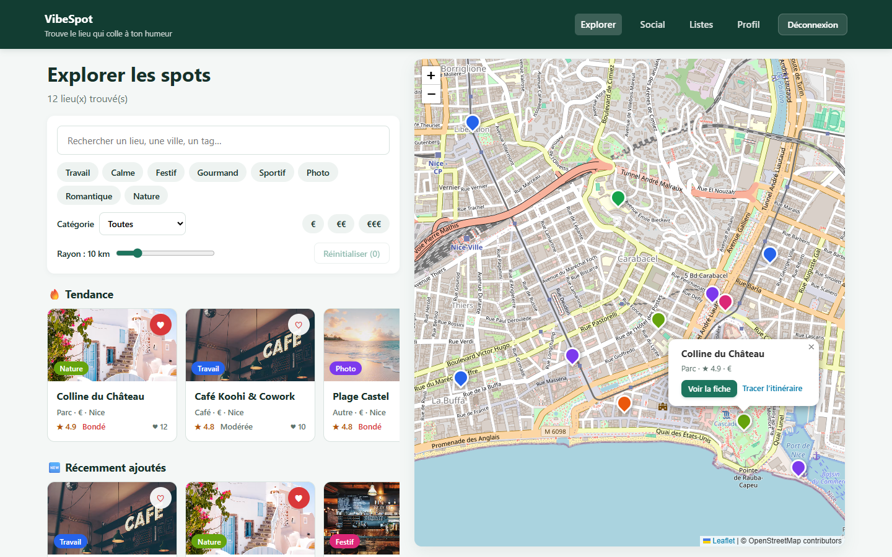
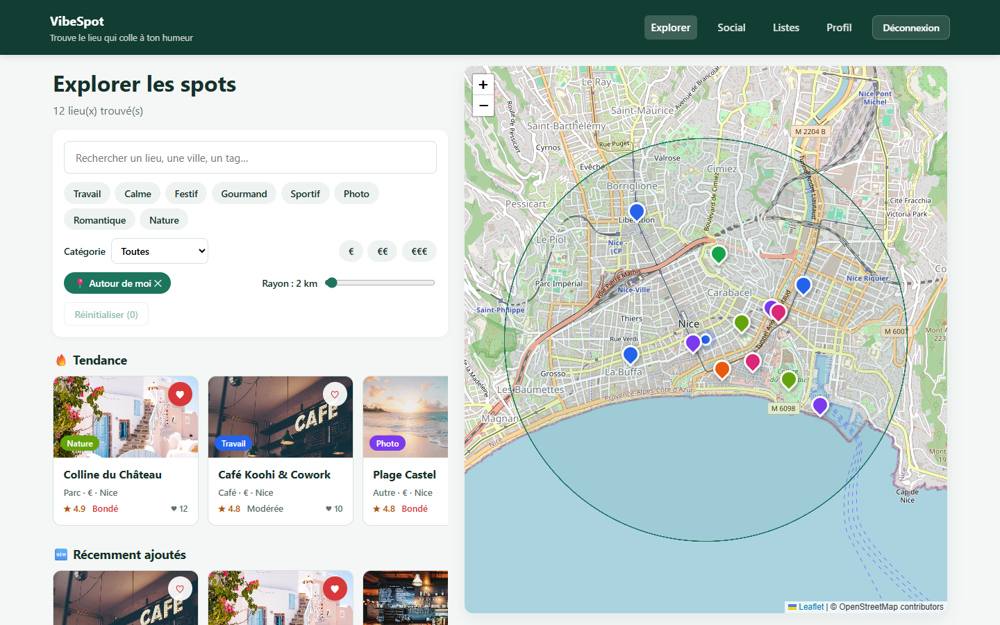
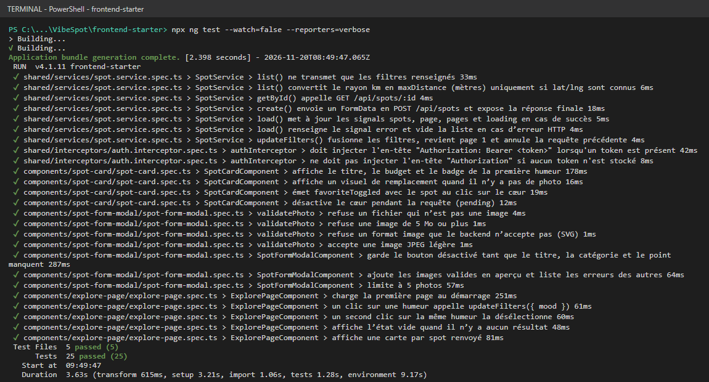
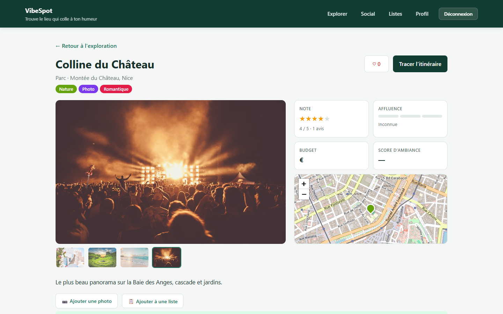
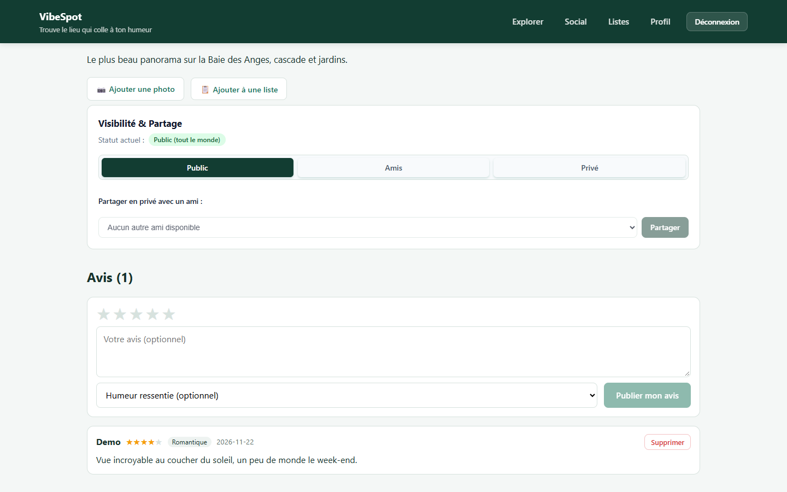
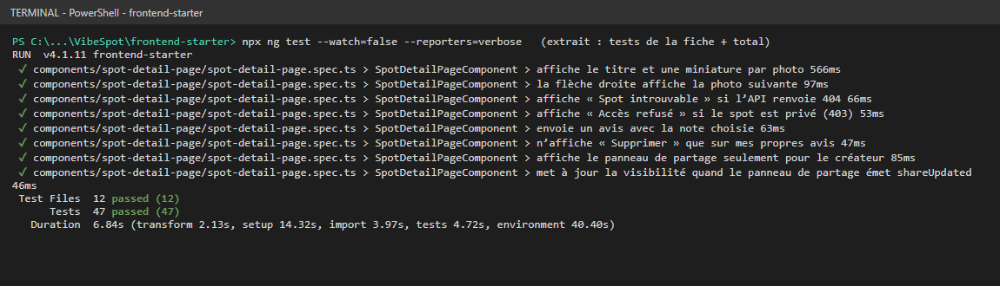

# Rapport d'usage de l'IA - TP4 / TP5 / TP6 (VibeSpot)

## Informations générales
- **Projet :** VibeSpot, découverte de lieux selon l'humeur (Angular 22, Express, MongoDB Atlas).
- **Binôme :** PISTONE Noa (Personne A : *Spots & Cartographie*) et BRAHMIA Noureddine (Personne B : *Social, Partage & Listes*, voir sa partie dans `RAPPORT_IA_MODELE.md`).
- **Git :** une branche chacun (`devnoa`, `devnoureddine`), fusionnées dans `devnoa`.
- **Modèle utilisé :** Claude Opus 5.5 avec Claude Code (extension VS Code).
- **Consommation de tokens :** *(à compléter)*
- **Pourquoi ce modèle :** il lit tout le dépôt avant de coder, suit les consignes des `CLAUDE.md` et lance lui-même le build et les tests.

> Le `backend/.env` n'était pas sur ma machine pendant les missions 1 et 2 : pour les captures de l'appli, j'ai utilisé une petite fausse API locale qui respecte `API_CONTRACT.md`.

---

## Mission 1.1 - Analyse du backend, modèles TypeScript et SpotService

### 1. Objectif
Comprendre l'API Spots écrite par mon binôme, puis créer les modèles TypeScript et le `SpotService` (appels HTTP + état de la recherche avec des Signals).

### 2. Prompts principaux
> « Avant toute modification, analyse le backend VibeSpot (`backend/src/app.js`, `backend/src/models/Spot.js`) et `API_CONTRACT.md`. Liste les routes `/api/spots*` avec leurs paramètres réels (`mood`, `category`, `budget`, `search`, `lat`, `lng`, `maxDistance` en mètres, `sort=popular|recent|rating`, `page`, `limit`), le format renvoyé par `toPublic()` et le format `Page<Spot>`. Repère dans `frontend-starter` ce qui relève de l'ancien domaine audio (`tracks-page`, `TrackService`, `Track`) et propose un plan de migration en petites étapes, sans encore écrire de code. »

> « Crée `src/app/shared/models/spot.model.ts` avec des types stricts correspondant exactement au `toPublic()` du backend : `Spot`, `SpotPhoto`, `Review`, `SpotMarker`, les unions `Mood`, `Category`, `Budget = 1 | 2 | 3`, `Affluence`, et une interface `SpotFilters`. Puis crée `SpotService` avec `inject(HttpClient)` : un état réactif `signal<Spot[]>`, `filters = signal<SpotFilters>`, `loading`, `error`, `page`, `pages`, et des `computed()` dérivés (par exemple `hasResults`). Ajoute les méthodes `list(filters)`, `map(filters)`, `trending(limit)`, `getById(id)`, `create(formData)` et `addPhoto(id, file)`. Construis les query params avec `HttpParams` en n'envoyant que les filtres définis. N'utilise ni `any`, ni constructeur, ni `console.log`. »

### 3. Plan proposé par l'agent
1. Lister les vraies routes et le format d'un Spot avant de coder.
2. `MOODS` et `CATEGORIES` en `as const` pour en déduire les types.
3. Signals privés exposés avec `asReadonly()`, `computed()` (`hasResults`, `hasNextPage`...), `load()` qui annule la requête précédente.
4. Rayon saisi en km, converti en `maxDistance` (mètres) seulement si on connaît la position.

### 4. Vérifications réalisées
- Comparaison du code Express avec `API_CONTRACT.md`.
- Build sans erreur de type.

### 5. Erreurs, interrogations et arbitrages techniques
- **Écarts avec le PDF :** les humeurs (*Focus, Chill...*) et `sort=trending` n'existent pas dans le backend. On suit le backend.
- **Bug backend trouvé :** avec `lat`/`lng`, `$nearSphere` était passé à `countDocuments`, ce qui donne une erreur 500. Corrigé au moment de la fusion (voir section Intégration).
- **Signal `spots` public et modifiable (comme dans le PDF) :** refusé, n'importe quel composant pourrait changer la liste.

### 6. Fichiers effectivement créés
- `frontend-starter/src/app/shared/models/spot.model.ts`
- `frontend-starter/src/app/shared/services/spot.service.ts`

### 7. Preuve de fonctionnement
Voir les tests de la Mission 1.2.

### 8. Ce que je sais expliquer sans l'agent
- Annuler la requête précédente évite qu'une vieille réponse arrive après la nouvelle et l'écrase (si on tape vite).
- `$nearSphere` trie par distance, donc MongoDB l'interdit dans un comptage. `$geoWithin` vérifie juste qu'un point est dans une zone.

---

## Mission 1.2 - Routes VibeSpot, suppression de l'audio et tests du SpotService

### 1. Objectif
Passer de *Guitar Practice Cloud* à VibeSpot (routes, navigation), supprimer le code audio, et tester le `SpotService`.

### 2. Prompts principaux
> « Remplace la route `/tracks` par les vues VibeSpot de ma partie : `/explore` (accueil, redirection par défaut) et `/spots/:id`, en lazy loading avec `loadComponent`. Ajoute aussi des emplacements pour `/social`, `/lists` et `/profile`, qui seront faits par mon binôme. Protège-les avec `authGuard`. Mets à jour la barre de navigation de `app.html` avec `routerLinkActive`. Supprime proprement `tracks-page`, `TrackService` et leurs tests sans casser le build, puis vérifie que `authInterceptor` reste inchangé. »

> « Écris `spot.service.spec.ts` avec `TestBed`, `provideHttpClient()` et `provideHttpClientTesting()`, compatible avec Vitest (`toBe(true)`, pas `toBeTrue()`). Les tests doivent couvrir : `list()` transmet uniquement les filtres renseignés, avec `maxDistance` converti de km en mètres ; `getById()` appelle `GET /api/spots/:id` ; `create()` envoie un `FormData` en `POST` ; les signals `loading` et `error` changent correctement en cas de succès et d'erreur HTTP. Termine par `httpMock.verify()`. »

### 3. Plan proposé par l'agent
1. Routes en `loadComponent`, `withComponentInputBinding()` pour lire l'`id` de la route dans un `input()`.
2. Page provisoire pour `/social` et `/lists` en attendant la partie B.
3. Suppression de `tracks-page`, `TrackService`, `Track`.
4. 7 tests du service (filtres vides, rayon, `getById`, `create`, `load` succès/erreur, annulation).

### 4. Vérifications réalisées
- Plus aucune référence à `tracks` dans `src/`.
- 9 tests sur 9 au vert (7 + 2 de l'intercepteur) et build OK.

### 5. Erreurs, interrogations et arbitrages techniques
- **Pas de `social-page` / `lists-page` vides :** pour éviter des conflits avec la branche de mon binôme.
- **Arborescence `core/` + `features/` du PDF non appliquée :** le `CLAUDE.md` demande de garder `shared/`.
- **Tests :** imports Vitest à la place des `declare function` de l'ancien test, et pas de `toBeTrue()` (problème déjà eu au TP3).

### 6. Fichiers effectivement modifiés
- `routes.ts`, `main.ts`, `index.html`, `app.*`, `login-page.ts`, `auth.interceptor.spec.ts`
- Créés : `explore-page/*`, `spot-detail-page/*`, `spot.service.spec.ts`
- Supprimés : `tracks-page/*`, `track.service.ts` (+ spec), `track.model.ts`

### 7. Preuve de fonctionnement

### 8. Ce que je sais expliquer sans l'agent
- Avec le lazy loading, le code d'une page n'est téléchargé que quand on y va.
- `httpMock.verify()` fait échouer le test si une requête part sans être attendue.

---

## Mission 2.1 - Page explore : écran partagé, filtres, carte Leaflet et géolocalisation

### 1. Objectif
Construire la page d'accueil : recherche et filtres à gauche, carte à droite, cartes de spots, favoris et bouton "Autour de moi".

### 2. Prompts principaux
> « Fais évoluer `explore-page` en vue « écran partagé » : à gauche (45 %) la recherche et les résultats, à droite (55 %) un emplacement pour la carte. Sous 900 px, la carte passe au-dessus de la liste. Dans la colonne de gauche, ajoute : un champ de recherche relié à `SpotService.updateFilters()` avec un délai de 300 ms (`debounceTime` + `distinctUntilChanged` sur un `FormControl`, désabonnement avec `takeUntilDestroyed`) ; des puces d'humeur générées à partir de `MOODS` (un clic sélectionne l'humeur, un second clic la désélectionne) ; un menu de catégories généré à partir de `CATEGORIES`, un choix de budget (€ / €€ / €€€), un curseur de rayon de 1 à 50 km et un bouton « Réinitialiser » qui affiche le nombre de filtres actifs (`activeFiltersCount`). Garde la pagination et les états chargement / erreur / vide déjà présents. N'ajoute aucun style en ligne. »

> « Crée un composant standalone `spot-card` avec `input.required<Spot>()` et un `output()` `favoriteToggled`. Il affiche la photo de couverture (avec une image de remplacement si `coverPhoto` est vide), le titre, le badge de la première humeur, la note, le budget et l'affluence, plus un bouton cœur. Utilise-le dans la grille de résultats de `explore-page`. Ajoute au-dessus de la grille : un carrousel horizontal « Tendance » alimenté par `SpotService.trending(6)` ; une section « Récemment ajoutés » (`list({ sort: 'recent' }, 1, 6)`). Le bouton cœur appelle `toggleFavorite()`. Mets à jour le compteur sans recharger la liste, et bloque le bouton pendant la requête pour éviter les doubles clics. Le clic sur la carte mène à `/spots/:id`. »

> « Installe `leaflet` et `@types/leaflet` et ajoute la feuille de style de Leaflet dans `angular.json`. Dans `explore-page` : initialise la carte dans `afterNextRender` (pas dans le constructeur ni dans `ngOnInit`), centrée sur Nice, avec les tuiles OpenStreetMap et leur attribution ; affiche les marqueurs de `SpotService.map()` sous forme de `L.divIcon` dont la couleur dépend de la première humeur (pas d'icônes PNG, pour éviter le problème des images Leaflet avec le bundler) ; au clic sur un marqueur, ouvre une popup avec le titre, la note, un lien vers la fiche et un bouton « Tracer l'itinéraire » qui ouvre Google Maps en mode itinéraire vers les coordonnées du spot ; recharge les marqueurs avec un `effect()` quand l'humeur ou la catégorie change, et détruis la carte dans `ngOnDestroy`. Explique pourquoi Leaflet doit être initialisé après le rendu. »

> « Ajoute un bouton « Autour de moi » qui utilise `navigator.geolocation.getCurrentPosition`. Si l'utilisateur accepte : place un marqueur « Vous êtes ici » ; recentre la carte ; passe `lat` / `lng` à `SpotService.updateFilters()` pour activer le filtre de rayon, et dessine un cercle (`L.circle`) de la taille du rayon choisi, mis à jour quand le curseur bouge. Si l'utilisateur refuse ou que la géolocalisation n'est pas disponible, affiche un message clair et n'envoie pas `lat` / `lng`. Si l'API renvoie une erreur 500 sur la recherche par rayon (bug backend connu, pas encore corrigé par mon binôme), affiche un message compréhensible au lieu de casser la page. Le bouton itinéraire doit maintenant partir de la position de l'utilisateur quand elle est connue. »

### 3. Plan proposé par l'agent
1. Grille `45fr 55fr`, recherche avec `debounceTime(300)`, filtres générés depuis `MOODS`, `CATEGORIES`, `BUDGETS`.
2. Composant `spot-card` qui émet juste un événement : c'est la page qui appelle l'API. Favoris gardés dans un `linkedSignal`.
3. Carte dans un composant séparé `spot-map` (réutilisé ensuite dans la modale de création, et facile à remplacer dans les tests).
4. Cercle de rayon qui suit le curseur en direct, mais requête envoyée seulement 250 ms après le dernier mouvement.

### 4. Vérifications réalisées
- En tapant "ca", une seule requête `search=ca` part. Le clic sur "Calme" relance la liste et les marqueurs (`map?mood=calme`).
- Le favori envoie seulement `POST /api/spots/:id/favorite`, sans recharger la liste.
- Avec une position simulée : `lat`, `lng` et `maxDistance=2000` pour un rayon de 2 km. Avec une erreur 500, un message clair s'affiche.
- Leaflet (environ 170 kB) n'est chargé que sur la page explore.

### 5. Erreurs, interrogations et arbitrages techniques
- **Session perdue après un F5 :** `AuthService` appelait `/api/users/me` pendant sa construction, et l'intercepteur avait besoin de `AuthService` (dépendance circulaire). Corrigé avec `restoreSession()` appelé par `provideAppInitializer`.
- **Popup Leaflet :** construite avec `textContent` et pas avec une chaîne HTML, sinon un titre contenant du HTML serait exécuté (XSS).
- **Photos du backend invisibles en dev :** le proxy ne redirigeait que `/api`. Ajout de `/uploads` dans `proxy.conf.json`.

### 6. Fichiers effectivement créés / modifiés
- Créés : `spot-card/*`, `spot-map/spot-map.ts`, `shared/utils/directions.ts`
- Modifiés : `explore-page/*`, `spot.model.ts`, `spot.service.ts`, `auth.service.ts`, `main.ts`, `styles.css`, `angular.json`, `proxy.conf.json`

### 7. Preuve de fonctionnement

### 8. Ce que je sais expliquer sans l'agent
- Leaflet a besoin d'un `div` déjà affiché et avec une taille, ce qui n'est pas le cas dans le constructeur ou `ngOnInit` : d'où `afterNextRender`.
- Un service ne peut pas utiliser pendant sa construction quelque chose qui dépend de lui : il faut attendre qu'il soit construit (`provideAppInitializer`).

---

## Mission 2.2 - Modale de création de spot et tests de la Mission 2

### 1. Objectif
Créer un spot depuis la page explore (point sur une mini-carte, jusqu'à 5 photos, progression de l'envoi) et tester les nouveaux composants.

### 2. Prompts principaux
> « Crée le composant standalone `spot-form-modal`, ouvert par un bouton flottant « + Ajouter un spot » dans `explore-page`. Il contient un formulaire réactif typé (`FormBuilder.nonNullable`) : titre (obligatoire), description, catégorie (obligatoire), humeurs (choix multiple), budget, adresse, ville ; une mini-carte Leaflet où un clic place le point et remplit `latitude` / `longitude` ; un upload de 5 photos maximum, chacune vérifiée avant l'envoi (`image/*`, moins de 5 Mo), avec des aperçus créés par `URL.createObjectURL` et révoqués à la suppression d'une photo ou à la fermeture. À l'envoi, la première photo part avec `SpotService.create()` (champ `photo`), puis les suivantes une par une avec `addPhoto()`. Affiche la progression de l'upload. Bloque le bouton pendant l'envoi et tant que le formulaire est invalide. En cas de succès : fermeture de la modale, message de confirmation et rechargement de la liste et des marqueurs. »

> « Écris les tests Vitest de la Mission 2, en bouchonnant `SpotService` et sans charger le vrai Leaflet : `spot-card` : affiche le titre et le budget, et émet `favoriteToggled` au clic sur le cœur ; `explore-page` : un clic sur une humeur appelle `updateFilters({ mood })`, et l'état vide s'affiche quand il n'y a aucun résultat ; `spot-form-modal` : refuse un fichier qui n'est pas une image ou qui dépasse 5 Mo, et garde le bouton d'envoi désactivé tant que le titre ou la catégorie manque. Lance ensuite `npx ng test --watch=false` et `npx ng build`, et corrige les erreurs sans affaiblir les tests. »

### 3. Plan proposé par l'agent
1. Réutiliser `spot-map` pour choisir le point (obligatoire, sinon le backend met le spot au centre de Nice).
2. `validatePhoto()` à part pour pouvoir la tester seule.
3. `create()` puis `concatMap(addPhoto)` pour envoyer les photos une par une. Si une photo échoue, le spot reste créé.
4. Tests : faux `SpotService` avec des signaux, et `overrideComponent` pour remplacer la carte par un composant vide (pas de Leaflet dans jsdom).

### 4. Vérifications réalisées
- Un `.txt` est refusé, les images s'affichent en aperçu. Dans Network : `POST /api/spots`, puis les `POST .../photos` l'un après l'autre.
- 25 tests sur 25 au vert (16 nouveaux) et build OK.

### 5. Erreurs, interrogations et arbitrages techniques
- **`image/*` trop large :** il laissait passer des formats que le backend refuse (SVG...). On reprend la liste exacte de `app.js` (JPEG, PNG, WebP, GIF).
- **Barre bloquée à 0 % en local :** le navigateur n'envoie presque pas d'événements de progression pour de petits fichiers. La barre avance aussi à la fin de chaque requête.
- **Avertissement NG0955 dans les tests :** notre faux `createObjectURL` renvoyait toujours la même URL. Corrigé pour en donner une différente à chaque appel, comme le vrai navigateur.

### 6. Fichiers effectivement créés
- `spot-form-modal/*` (+ spec), `spot-card.spec.ts`, `explore-page.spec.ts`, `shared/testing/spot-fixtures.ts`

### 7. Preuve de fonctionnement

### 8. Ce que je sais expliquer sans l'agent
- `URL.createObjectURL` crée un lien local vers le fichier pour l'aperçu, il faut le libérer avec `revokeObjectURL` (comme pour l'audio au TP2).
- `concatMap` attend la fin d'une requête avant la suivante, `mergeMap` les lancerait toutes en même temps.

---

## Mission 3 - Fiche détaillée d'un spot (`spot-detail-page`)

> À partir de cette mission, tout est testé avec le vrai backend et la vraie base Atlas. Les spots de démo ont été créés avec ma modale de création (Mission 2), ce qui a aussi testé le vrai envoi de photos.

### 1. Objectif
Construire la fiche `/spots/:id` : galerie, indicateurs, avis, ajout de photo, ajout à une liste, et y intégrer le panneau de partage de mon binôme.

### 2. Prompts principaux
> « Fais évoluer `spot-detail-page` (route `/spots/:id`, `id` reçu par `input()`) : en-tête avec titre, catégorie, adresse et badges d'humeur ; galerie photo (grande photo, miniatures cliquables, navigation clavier ← / →, visuel de remplacement sans photo) ; indicateurs : note moyenne en étoiles avec le nombre d'avis, jauge d'affluence (`faible` / `moderee` / `elevee` / `inconnue`), budget, compteur de favoris avec le bouton cœur, et lien « Tracer l'itinéraire ». Ajoute une mini-carte `spot-map` centrée sur le spot. Gère les erreurs 404 (spot introuvable) et 403 (spot privé non partagé) avec un message clair et un lien de retour vers `/explore`. »

> « Dans `spot-detail-page`, ajoute : un formulaire d'avis (note de 1 à 5 obligatoire, commentaire de 500 caractères maximum, humeur ressentie) qui appelle `SpotService.addReview()` et remplace le spot affiché par la réponse ; la liste des avis du plus récent au plus ancien, avec un bouton de suppression visible uniquement sur mes propres avis (confirmation, puis `deleteReview()`) ; un bouton « Ajouter une photo » avec la même validation que la modale de création (`validatePhoto`) et une barre de progression ; un menu « Ajouter à une liste » qui charge mes listes avec `ListService.loadLists()` et appelle `addSpotToList()`. Bloque chaque bouton pendant sa requête et affiche un message de succès ou d'erreur. »

> « Intègre le `SharePanelComponent` de mon binôme dans `spot-detail-page`, affiché seulement si je suis le créateur du spot, en lui passant `spotId`, `title`, `ownerId`, `visibility` et `sharedWith`, et mets à jour le spot affiché quand `shareUpdated` est émis. Écris ensuite les tests Vitest de la fiche, avec un faux `SpotService` et en remplaçant `spot-map` et `share-panel` par des composants vides : affichage du titre et de la galerie, message pour 404 et pour 403, envoi d'un avis avec la bonne note, bouton de suppression présent seulement sur mes avis, et panneau de partage visible uniquement pour le créateur. Lance `npx ng test --watch=false` et `npx ng build`. »

### 3. Plan proposé par l'agent
1. Galerie avec un `linkedSignal` pour l'index de la photo (revient à 0 quand on change de spot), étoiles et jauge calculées avec des `computed()`.
2. Réutilisation de ce qui existe : `spot-map` pour la mini-carte, `validatePhoto()` de la modale, `ListService` et `SharePanelComponent` de la partie B.
3. Après chaque action (avis, photo), on remplace le spot par la réponse de l'API au lieu de tout recharger.
4. 8 tests avec la carte et le panneau de partage remplacés par des composants vides.

### 4. Vérifications réalisées
- Sur la vraie base : avis 4★ publié (la note passe à 4/5), photo ajoutée et affichée directement, spot ajouté à une liste, et passage "Public" → "Amis" → "Public" avec le panneau de partage (`PATCH /api/spots/:id/share` → 200).
- Un id inexistant affiche "Spot introuvable". Le 403 est vérifié par un test (impossible à reproduire avec un seul compte).
- 47 tests sur 47 au vert (8 nouveaux) et build OK.

### 5. Erreurs, interrogations et arbitrages techniques
- **Page blanche en ouvrant directement `/spots/:id` :** il manquait `<base href="/">` dans `index.html`. Le navigateur cherchait `styles.css` et `main.js` dans `/spots/`. Ça ne se voyait pas avant car toutes les routes n'avaient qu'un niveau (`/tracks`, `/login`).
- **Listes de la partie B :** selon la route, le backend renvoie les spots d'une liste complets ou seulement leurs ids. La vérification "déjà dans la liste" gère les deux cas.
- **Humeur des avis :** c'est un texte libre côté backend, donc on affiche le libellé seulement si l'humeur est connue.

### 6. Fichiers effectivement créés / modifiés
- `spot-detail-page.{ts,html,css}` (réécrits), `spot-detail-page.spec.ts` (créé)
- `src/index.html` (`<base href="/">`)

### 7. Preuve de fonctionnement

### 8. Ce que je sais expliquer sans l'agent
- `linkedSignal` garde une valeur modifiable (la photo affichée) mais la réinitialise quand sa source change (le spot).
- Le panneau de partage communique avec la fiche par `input()` / `output()` : la fiche ne sait pas comment il fonctionne, elle met juste à jour sa visibilité quand il émet `shareUpdated`.

---

## Intégration - Fusion de la partie B dans `devnoa`

### 1. Objectif
Récupérer le travail de mon binôme (`devnoureddine`) dans ma branche, gérer les conflits et vérifier que tout fonctionne ensemble.

### 2. Prompt principal
> « Vérifie sur la branche devnoureddine tout ce qui a été fait, il est censé avoir fait ces 3 missions, dis-moi un peu et on essaye de récupérer son code dans devnoa, gérer les conflits etc. »

### 3. Plan proposé par l'agent
1. Lire les commits et le diff de la branche avant de fusionner.
2. `git merge --no-commit` pour voir les conflits sans rien valider.
3. Brancher les pages `/social` et `/lists` dans `routes.ts`, puis build et tests.

### 4. Vérifications réalisées
- Seul conflit Git : `package.json` / `package-lock.json` (Leaflet de mon côté, Angular CDK du sien). Les deux dépendances gardées, lock régénéré avec `npm install`.
- 39 tests sur 39 au vert (25 + 14 de la partie B), build OK, et les 37 routes Express bien déclarées.

### 5. Erreurs, interrogations et arbitrages techniques
- **Routes supprimées par erreur :** `POST`, `PUT` et `DELETE /api/spots` avaient disparu de sa version du backend, ce qui cassait la création de spot. Rétablies depuis `main`, avec en plus le champ `visibility`.
- **Bug `$nearSphere` toujours présent :** remplacé par `$geoWithin` + `$centerSphere`, qui marche avec `countDocuments`.
- **Rien n'a été modifié dans son rapport ni dans ses captures.**

### 6. Fichiers effectivement modifiés
- `backend/src/app.js`, `API_CONTRACT.md` (champ `visibility` à la création)
- `frontend-starter/package.json`, `package-lock.json`, `routes.ts`, `spot.model.ts` (`visibility`, `sharedWith`)
- Supprimé : `placeholder-page.ts`

### 7. Preuve de fonctionnement
Tests et build au vert après la fusion (39/39).

### 8. Ce que je sais expliquer sans l'agent
- Un `package-lock.json` en conflit ne se corrige pas à la main : on garde une version, on fusionne le `package.json`, puis on régénère le lock avec `npm install`.
- `--no-commit` permet de vérifier et corriger la fusion (build, tests) avant de la valider.
