# Rapport d'usage de l'IA - TP4, TP5 et TP6 (VibeSpot)

## Informations générales
- **Projet :** VibeSpot, découverte de lieux selon l'humeur (Angular 22, Express, MongoDB Atlas).
- **Binôme :** PISTONE Noa (partie A : spots et carte) et BRAHMIA Noureddine (partie B : social, partage et listes). REPORT.md et build final en commun.
- **Git :** une branche chacun (`devnoa`, `devnoureddine`), mises à jour depuis `main`.
- **Modèle utilisé :** Claude Opus 5.5 avec Claude Code (extension VS Code).
- **Consommation de tokens :** *(à compléter)*
- **Pourquoi ce modèle :** il lit tout le dépôt avant de coder, suit les consignes des CLAUDE.md et lance lui-même le build et les tests.

---

## TP4 - Mission 1 : Socle frontend et SpotService (partie A - Noa)

### Prompt 1.1 - Analyse du backend

#### 1. Objectif
Comprendre l'API Spots de mon binôme et repérer le code audio à supprimer, sans rien modifier.

#### 2. Prompt principal
> « Avant toute modification, analyse le backend VibeSpot (`backend/src/app.js`, `backend/src/models/Spot.js`) et `API_CONTRACT.md`. Liste les routes `/api/spots*` avec leurs paramètres réels (`mood`, `category`, `budget`, `search`, `lat`, `lng`, `maxDistance` en mètres, `sort=popular|recent|rating`, `page`, `limit`), le format renvoyé par `toPublic()` et le format `Page<Spot>`. Repère dans `frontend-starter` ce qui relève de l'ancien domaine audio (`tracks-page`, `TrackService`, `Track`) et propose un plan de migration en petites étapes, sans encore écrire de code. »

#### 3. Plan proposé par l'agent
Lister les routes et le format d'un Spot, lister les fichiers audio à supprimer, puis avancer dans l'ordre : modèles, service, routes, tests.

#### 4. Vérifications réalisées
Comparaison du code Express avec API_CONTRACT.md, et recherche de `tracks` dans `src/` (10 fichiers).

#### 5. Erreurs ou propositions rejetées
- Les humeurs et le `sort=trending` du PDF n'existent pas dans le backend : on suit le backend.
- Le projet utilise Vitest et non Jasmine.
- Bug trouvé dans le backend : avec `lat`/`lng`, `$nearSphere` est passé à `countDocuments`, ce qui donne une erreur 500. Signalé à mon binôme, c'est sa partie.

#### 6. Fichiers inspectés
`backend/src/app.js`, `Spot.js`, `API_CONTRACT.md`, `routes.ts`, `main.ts`, `track.service.ts`.

#### 7. Preuve de fonctionnement
Pas de capture, c'était seulement de l'analyse.

#### 8. Ce que je sais expliquer sans l'agent
`$nearSphere` trie par distance, donc il est interdit dans un comptage. `$geoWithin` vérifie seulement qu'un point est dans une zone, il marche avec `countDocuments`.

---

### Prompt 1.2 - Modèles TypeScript et SpotService

#### 1. Objectif
Typer les Spots comme le backend les renvoie et créer un service qui gère les appels HTTP et l'état de la recherche avec des Signals.

#### 2. Prompt principal
> « Crée `src/app/shared/models/spot.model.ts` avec des types stricts correspondant exactement au `toPublic()` du backend : `Spot`, `SpotPhoto`, `Review`, `SpotMarker`, les unions `Mood`, `Category`, `Budget = 1 | 2 | 3`, `Affluence`, et une interface `SpotFilters`. Puis crée `SpotService` avec `inject(HttpClient)` : un état réactif `signal<Spot[]>`, `filters = signal<SpotFilters>`, `loading`, `error`, `page`, `pages`, et des `computed()` dérivés (par exemple `hasResults`). Ajoute les méthodes `list(filters)`, `map(filters)`, `trending(limit)`, `getById(id)`, `create(formData)` et `addPhoto(id, file)`. Construis les query params avec `HttpParams` en n'envoyant que les filtres définis. N'utilise ni `any`, ni constructeur, ni `console.log`. »

#### 3. Plan proposé par l'agent
- Listes `MOODS` et `CATEGORIES` en `as const` pour en déduire les types.
- Méthodes HTTP qui renvoient des Observables, signals privés exposés en lecture seule, `computed()` pour `hasResults`, `hasNextPage`, etc.
- `load()` annule la requête précédente ; le rayon en km est converti en `maxDistance` (mètres) seulement si on a la position.

#### 4. Vérifications réalisées
Build sans erreur de type, comparaison de l'interface `Spot` avec `toPublic()`.

#### 5. Erreurs ou propositions rejetées
- Signal `spots` public et modifiable (comme dans le PDF) : refusé, on utilise `asReadonly()`.
- `create()` renvoie les événements HTTP et pas juste le Spot, pour afficher la progression de l'upload.

#### 6. Fichiers créés
`shared/models/spot.model.ts`, `shared/services/spot.service.ts`.

#### 7. Preuve de fonctionnement
Les 7 tests du service passent :
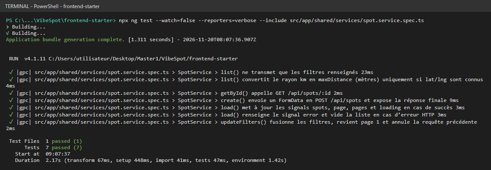

#### 8. Ce que je sais expliquer sans l'agent
Annuler la requête précédente évite qu'une vieille réponse écrase la nouvelle si on tape vite. Un `computed` se recalcule tout seul quand les signals dont il dépend changent.

---

### Prompt 1.3 - Routes, navigation et suppression de l'audio

#### 1. Objectif
Passer de Guitar Practice Cloud à VibeSpot sans toucher à l'intercepteur ni au guard.

#### 2. Prompt principal
> « Remplace la route `/tracks` par les vues VibeSpot de ma partie : `/explore` (accueil, redirection par défaut) et `/spots/:id`, en lazy loading avec `loadComponent`. Ajoute aussi des emplacements pour `/social`, `/lists` et `/profile`, qui seront faits par mon binôme. Protège-les avec `authGuard`. Mets à jour la barre de navigation de `app.html` avec `routerLinkActive`. Supprime proprement `tracks-page`, `TrackService` et leurs tests sans casser le build, puis vérifie que `authInterceptor` reste inchangé. »

#### 3. Plan proposé par l'agent
Nouvelles routes en `loadComponent`, page provisoire pour `/social` et `/lists`, `withComponentInputBinding()` pour récupérer l'`id` dans un `input()`, première version d'`explore-page` et `spot-detail-page`, nouvelle navigation, suppression des fichiers audio.

#### 4. Vérifications réalisées
Plus aucune référence à `tracks`, le build passe avec un fichier séparé par page.

#### 5. Erreurs ou propositions rejetées
- Créer tout de suite `social-page` et `lists-page` : refusé pour ne pas avoir de conflits avec mon binôme.
- L'arborescence `core/` + `features/` du PDF n'est pas appliquée, le CLAUDE.md demande de garder `shared/`.

#### 6. Fichiers modifiés / créés / supprimés
- Modifiés : `routes.ts`, `main.ts`, `index.html`, `app.*`, `login-page.ts`, `auth.interceptor.spec.ts`
- Créés : `explore-page/*`, `spot-detail-page/*`, `placeholder-page.ts`
- Supprimés : `tracks-page/*`, `track.service.ts` (+ spec), `track.model.ts`

#### 7. Preuve de fonctionnement
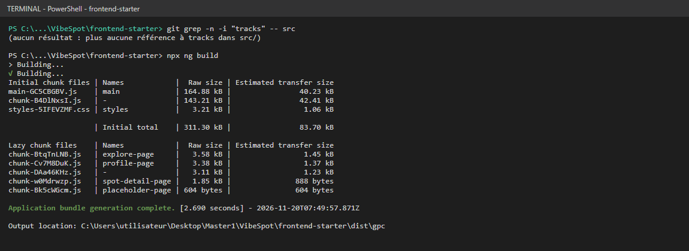

#### 8. Ce que je sais expliquer sans l'agent
Avec le lazy loading, le code d'une page n'est chargé que quand on y va. Le guard sert à l'affichage, la vraie sécurité est dans le backend.

---

### Prompt 1.4 - Tests du SpotService

#### 1. Objectif
Tester le service sans backend, avec `HttpTestingController` et Vitest.

#### 2. Prompt principal
> « Écris `spot.service.spec.ts` avec `TestBed`, `provideHttpClient()` et `provideHttpClientTesting()`, compatible avec Vitest (`toBe(true)`, pas `toBeTrue()`). Les tests doivent couvrir : `list()` transmet uniquement les filtres renseignés, avec `maxDistance` converti de km en mètres ; `getById()` appelle `GET /api/spots/:id` ; `create()` envoie un `FormData` en `POST` ; les signals `loading` et `error` changent correctement en cas de succès et d'erreur HTTP. Termine par `httpMock.verify()`. »

#### 3. Plan proposé par l'agent
7 tests : filtres vides non envoyés, conversion du rayon, `getById`, `create` en FormData, `load` en succès et en erreur, `updateFilters` qui annule la requête précédente.

#### 4. Vérifications réalisées
9 tests sur 9 passent (avec ceux de l'intercepteur) et le build passe.

#### 5. Erreurs ou propositions rejetées
On utilise les imports de Vitest à la place des `declare function` de l'ancien test, et pas de `toBeTrue()` (problème déjà eu au TP3).

#### 6. Fichiers créés / modifiés
`spot.service.spec.ts` (créé), `auth.interceptor.spec.ts` (URL changée).

#### 7. Preuve de fonctionnement

#### 8. Ce que je sais expliquer sans l'agent
`httpMock.verify()` fait échouer le test si une requête part sans être attendue. Ces tests ne testent que le frontend, ils n'auraient pas trouvé le bug du backend.

---

## TP4 - Mission 2 : Page explore, carte et création de spot (partie A - Noa)

> Je n'avais pas encore le `backend/.env` (identifiants Atlas). Pour les captures, j'ai utilisé une petite fausse API locale qui respecte `API_CONTRACT.md`. Les captures "Network" viennent des vraies requêtes envoyées par l'appli.

### Prompt 2.1 - Écran partagé et filtres

#### 1. Objectif
Mettre la recherche à gauche et la carte à droite, avec les filtres humeur, catégorie, budget et rayon.

#### 2. Prompt principal
> « Fais évoluer `explore-page` en vue « écran partagé » : à gauche (45 %) la recherche et les résultats, à droite (55 %) un emplacement pour la carte. Sous 900 px, la carte passe au-dessus de la liste. Dans la colonne de gauche, ajoute : un champ de recherche relié à `SpotService.updateFilters()` avec un délai de 300 ms (`debounceTime` + `distinctUntilChanged` sur un `FormControl`, désabonnement avec `takeUntilDestroyed`) ; des puces d'humeur générées à partir de `MOODS` (un clic sélectionne l'humeur, un second clic la désélectionne) ; un menu de catégories généré à partir de `CATEGORIES`, un choix de budget (€ / €€ / €€€), un curseur de rayon de 1 à 50 km et un bouton « Réinitialiser » qui affiche le nombre de filtres actifs (`activeFiltersCount`). Garde la pagination et les états chargement / erreur / vide déjà présents. N'ajoute aucun style en ligne. »

#### 3. Plan proposé par l'agent
Grille CSS `45fr 55fr`, recherche avec `debounceTime(300)`, filtres générés depuis `MOODS`, `CATEGORIES` et `BUDGETS`, couleurs des humeurs en variables CSS globales (réutilisées sur la carte).

#### 4. Vérifications réalisées
En tapant "ca", une seule requête `search=ca` part. Le clic sur "Calme" ajoute `mood=calme`.

#### 5. Erreurs ou propositions rejetées
- `$any($event.target).value` sur le `select` remplacé par une variable de template, pour éviter `any`.
- Bug trouvé : après un F5, on était toujours déconnecté. `AuthService` appelait `/api/users/me` pendant sa construction et l'intercepteur avait besoin de `AuthService` (dépendance circulaire). Corrigé avec `restoreSession()` appelé par `provideAppInitializer`.

#### 6. Fichiers modifiés
`explore-page.*`, `spot.model.ts`, `spot.service.ts`, `styles.css`, `auth.service.ts`, `main.ts`.

#### 7. Preuve de fonctionnement
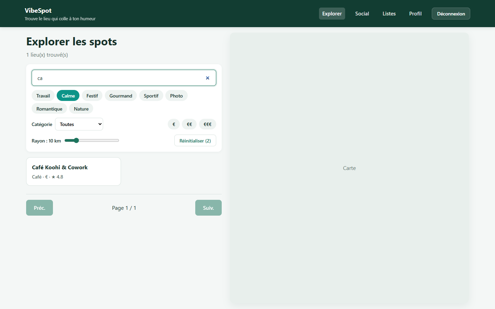
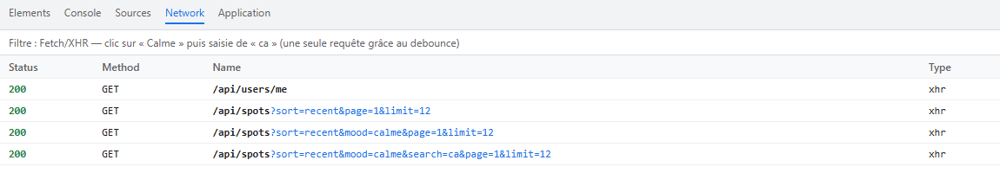

#### 8. Ce que je sais expliquer sans l'agent
`debounceTime(300)` attend 300 ms sans frappe avant d'envoyer, donc pas une requête par lettre. Un service ne peut pas utiliser pendant sa construction quelque chose qui dépend de lui, d'où `provideAppInitializer`.

---

### Prompt 2.2 - Cartes de spot, Tendance, Récents et favori

#### 1. Objectif
Afficher les spots en cartes avec photo, ajouter les sections "Tendance" et "Récemment ajoutés", et le bouton favori.

#### 2. Prompt principal
> « Crée un composant standalone `spot-card` avec `input.required<Spot>()` et un `output()` `favoriteToggled`. Il affiche la photo de couverture (avec une image de remplacement si `coverPhoto` est vide), le titre, le badge de la première humeur, la note, le budget et l'affluence, plus un bouton cœur. Utilise-le dans la grille de résultats de `explore-page`. Ajoute au-dessus de la grille : un carrousel horizontal « Tendance » alimenté par `SpotService.trending(6)` ; une section « Récemment ajoutés » (`list({ sort: 'recent' }, 1, 6)`). Le bouton cœur appelle `toggleFavorite()`. Mets à jour le compteur sans recharger la liste, et bloque le bouton pendant la requête pour éviter les doubles clics. Le clic sur la carte mène à `/spots/:id`. »

#### 3. Plan proposé par l'agent
La carte émet juste un événement, c'est la page qui appelle l'API. Favoris gardés dans un `linkedSignal` (initialisé depuis le profil), signal `favoritePending` pour bloquer le bouton. Ajout de `/uploads` dans le proxy pour afficher les photos du backend.

#### 4. Vérifications réalisées
Le clic sur le cœur envoie seulement `POST /api/spots/:id/favorite`, sans recharger la liste, et le compteur change.

#### 5. Erreurs ou propositions rejetées
- Les photos en portrait déformaient les cartes : image passée en `position: absolute`.
- Le libellé d'affluence "Calme" se confondait avec l'humeur "Calme" : renommé "Peu de monde".

#### 6. Fichiers créés / modifiés
`spot-card/*` (créé), `explore-page.*`, `user.model.ts`, `proxy.conf.json`.

#### 7. Preuve de fonctionnement
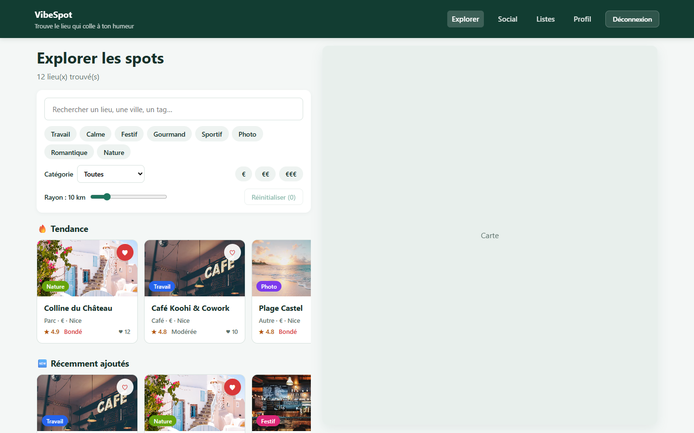
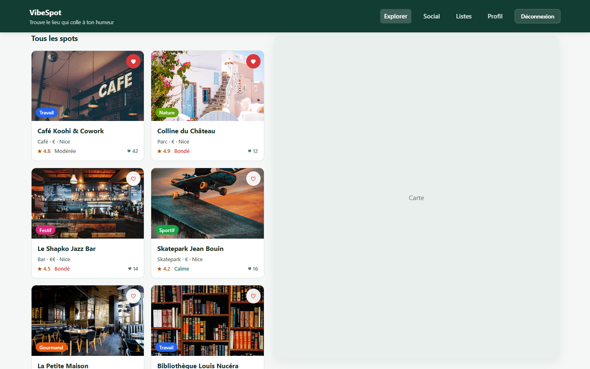
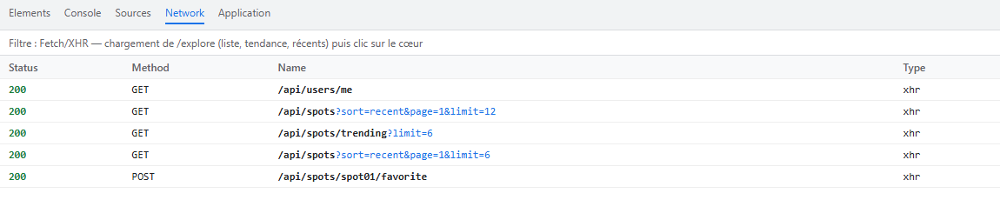

#### 8. Ce que je sais expliquer sans l'agent
Comme la carte ne fait pas d'appel HTTP, on peut la réutiliser partout. `linkedSignal` se recalcule quand sa source change, mais on peut aussi le modifier à la main.

---

### Prompt 2.3 - Carte Leaflet, marqueurs et itinéraire

#### 1. Objectif
Afficher les spots sur une carte, avec des marqueurs colorés par humeur, une popup et un lien d'itinéraire.

#### 2. Prompt principal
> « Installe `leaflet` et `@types/leaflet` et ajoute la feuille de style de Leaflet dans `angular.json`. Dans `explore-page` : initialise la carte dans `afterNextRender` (pas dans le constructeur ni dans `ngOnInit`), centrée sur Nice, avec les tuiles OpenStreetMap et leur attribution ; affiche les marqueurs de `SpotService.map()` sous forme de `L.divIcon` dont la couleur dépend de la première humeur (pas d'icônes PNG, pour éviter le problème des images Leaflet avec le bundler) ; au clic sur un marqueur, ouvre une popup avec le titre, la note, un lien vers la fiche et un bouton « Tracer l'itinéraire » qui ouvre Google Maps en mode itinéraire vers les coordonnées du spot ; recharge les marqueurs avec un `effect()` quand l'humeur ou la catégorie change, et détruis la carte dans `ngOnDestroy`. Explique pourquoi Leaflet doit être initialisé après le rendu. »

#### 3. Plan proposé par l'agent
Mettre la carte dans un composant à part (`spot-map`), réutilisable dans la modale de création et facile à remplacer dans les tests. Un `computed` ne garde que l'humeur et la catégorie, pour ne pas recharger les marqueurs à chaque lettre tapée.

#### 4. Vérifications réalisées
Les marqueurs et la popup s'affichent. Cliquer sur "Calme" relance `/api/spots/map?mood=calme`, mais taper dans la recherche ne relance pas la carte. Leaflet (environ 170 kB) n'est chargé que sur la page explore.

#### 5. Erreurs ou propositions rejetées
- Popup construite avec `textContent` et pas avec une chaîne HTML, sinon un titre contenant du HTML serait exécuté (XSS).
- `moods` n'est pas une enum dans Mongoose : on vérifie que l'humeur fait partie de `MOODS` avant de la mettre dans le HTML du marqueur.

#### 6. Fichiers créés / modifiés
`spot-map.ts`, `shared/utils/directions.ts` (créés), `explore-page.*`, `styles.css`, `angular.json`.

#### 7. Preuve de fonctionnement

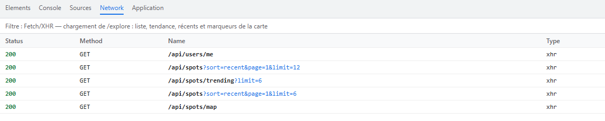

#### 8. Ce que je sais expliquer sans l'agent
Leaflet a besoin d'un `div` déjà affiché et avec une taille, ce qui n'est pas le cas dans le constructeur ou `ngOnInit`. Les styles des marqueurs sont globaux car Leaflet crée ses éléments en dehors du template Angular.

---

### Prompt 2.4 - Géolocalisation et filtre de rayon

#### 1. Objectif
Ajouter un bouton "Autour de moi" qui filtre les spots par distance, avec un cercle sur la carte.

#### 2. Prompt principal
> « Ajoute un bouton « Autour de moi » qui utilise `navigator.geolocation.getCurrentPosition`. Si l'utilisateur accepte : place un marqueur « Vous êtes ici » ; recentre la carte ; passe `lat` / `lng` à `SpotService.updateFilters()` pour activer le filtre de rayon, et dessine un cercle (`L.circle`) de la taille du rayon choisi, mis à jour quand le curseur bouge. Si l'utilisateur refuse ou que la géolocalisation n'est pas disponible, affiche un message clair et n'envoie pas `lat` / `lng`. Si l'API renvoie une erreur 500 sur la recherche par rayon (bug backend connu, pas encore corrigé par mon binôme), affiche un message compréhensible au lieu de casser la page. Le bouton itinéraire doit maintenant partir de la position de l'utilisateur quand elle est connue. »

#### 3. Plan proposé par l'agent
Le cercle suit le curseur en direct, mais la requête part seulement 250 ms après le dernier mouvement. Un `computed` `errorMessage` affiche un message spécial si on a une erreur 500 avec le filtre de distance.

#### 4. Vérifications réalisées
Avec une position simulée, la requête contient `lat`, `lng` et `maxDistance=10000`, puis `maxDistance=2000` après avoir mis le curseur à 2 km. Avec une erreur 500, le message s'affiche et la page marche toujours.

#### 5. Erreurs ou propositions rejetées
Envoyer le rayon à chaque cran du curseur aurait fait une requête par kilomètre : on sépare l'affichage du cercle et l'appel à l'API.

#### 6. Fichiers modifiés
`explore-page.*`, `spot-map.ts`, `spot.service.ts`.

#### 7. Preuve de fonctionnement

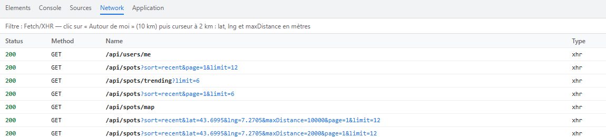
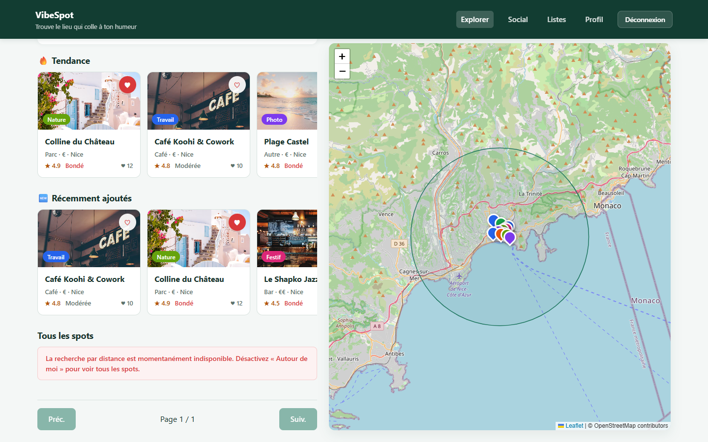

#### 8. Ce que je sais expliquer sans l'agent
`getCurrentPosition` demande l'autorisation à l'utilisateur, donc il faut gérer le refus. La géolocalisation ne marche qu'en HTTPS ou sur `localhost`.

---

### Prompt 2.5 - Modale de création de spot

#### 1. Objectif
Créer un spot depuis la page explore : formulaire, point choisi sur une mini-carte et plusieurs photos avec une barre de progression.

#### 2. Prompt principal
> « Crée le composant standalone `spot-form-modal`, ouvert par un bouton flottant « + Ajouter un spot » dans `explore-page`. Il contient un formulaire réactif typé (`FormBuilder.nonNullable`) : titre (obligatoire), description, catégorie (obligatoire), humeurs (choix multiple), budget, adresse, ville ; une mini-carte Leaflet où un clic place le point et remplit `latitude` / `longitude` ; un upload de 5 photos maximum, chacune vérifiée avant l'envoi (`image/*`, moins de 5 Mo), avec des aperçus créés par `URL.createObjectURL` et révoqués à la suppression d'une photo ou à la fermeture. À l'envoi, la première photo part avec `SpotService.create()` (champ `photo`), puis les suivantes une par une avec `addPhoto()`. Affiche la progression de l'upload. Bloque le bouton pendant l'envoi et tant que le formulaire est invalide. En cas de succès : fermeture de la modale, message de confirmation et rechargement de la liste et des marqueurs. »

#### 3. Plan proposé par l'agent
Réutiliser `spot-map` pour choisir le point (obligatoire, sinon le backend met le spot au centre de Nice). Fonction `validatePhoto()` à part pour pouvoir la tester. Envoi avec `create()` puis `concatMap(addPhoto)` pour les autres photos ; si une photo échoue, le spot reste créé.

#### 4. Vérifications réalisées
Un `.txt` est refusé avec un message, les 3 images s'affichent en aperçu. Dans Network : `POST /api/spots`, puis deux `POST .../photos` l'un après l'autre, puis rechargement.

#### 5. Erreurs ou propositions rejetées
- `image/*` aurait laissé passer des formats que le backend refuse (SVG...) : on reprend la liste exacte de `app.js` (JPEG, PNG, WebP, GIF).
- La barre restait à 0 % en local (presque pas d'événements de progression pour de petits fichiers) : elle avance aussi à la fin de chaque requête.

#### 6. Fichiers créés / modifiés
`spot-form-modal/*` (créé), `explore-page.*`.

#### 7. Preuve de fonctionnement
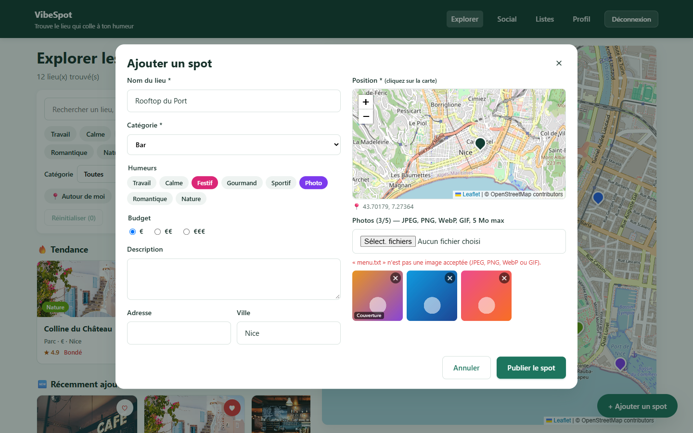
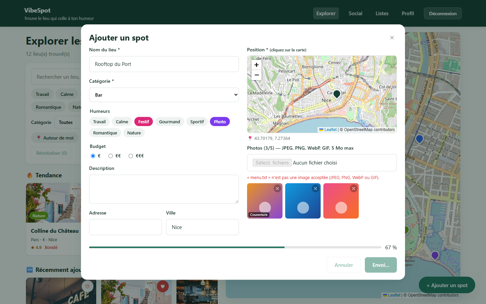
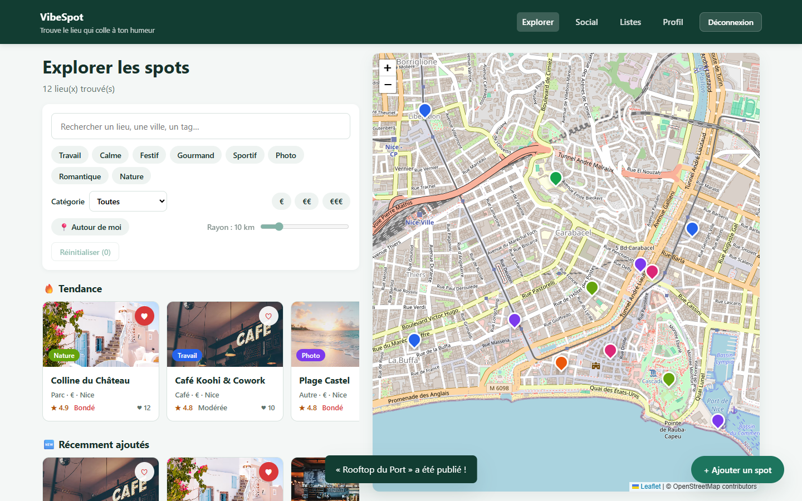
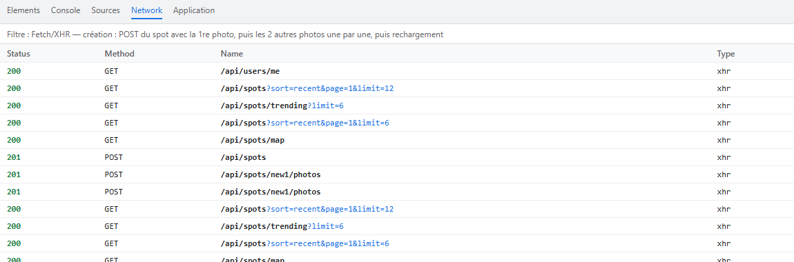

#### 8. Ce que je sais expliquer sans l'agent
`URL.createObjectURL` crée un lien local vers le fichier pour l'aperçu, il faut le libérer avec `revokeObjectURL` (comme pour l'audio au TP2). `concatMap` attend la fin d'une requête avant la suivante, `mergeMap` les lancerait toutes en même temps.

---

### Prompt 2.6 - Tests de la Mission 2

#### 1. Objectif
Tester `spot-card`, `explore-page` et `spot-form-modal` sans backend et sans Leaflet.

#### 2. Prompt principal
> « Écris les tests Vitest de la Mission 2, en bouchonnant `SpotService` et sans charger le vrai Leaflet : `spot-card` : affiche le titre et le budget, et émet `favoriteToggled` au clic sur le cœur ; `explore-page` : un clic sur une humeur appelle `updateFilters({ mood })`, et l'état vide s'affiche quand il n'y a aucun résultat ; `spot-form-modal` : refuse un fichier qui n'est pas une image ou qui dépasse 5 Mo, et garde le bouton d'envoi désactivé tant que le titre ou la catégorie manque. Lance ensuite `npx ng test --watch=false` et `npx ng build`, et corrige les erreurs sans affaiblir les tests. »

#### 3. Plan proposé par l'agent
Un faux `SpotService` avec des signaux et des `vi.fn()`, et `TestBed.overrideComponent` pour remplacer la carte et la modale par des composants vides. 16 nouveaux tests.

#### 4. Vérifications réalisées
25 tests sur 25 passent (9 de la Mission 1 et 16 nouveaux), et le build passe.

#### 5. Erreurs ou propositions rejetées
Avertissement NG0955 (clés en double dans le `@for` des aperçus) : notre faux `createObjectURL` renvoyait toujours la même URL. On l'a corrigé pour qu'il en donne une différente à chaque fois, comme le vrai navigateur.

#### 6. Fichiers créés
`spot-card.spec.ts`, `explore-page.spec.ts`, `spot-form-modal.spec.ts`, `shared/testing/spot-fixtures.ts`.

#### 7. Preuve de fonctionnement

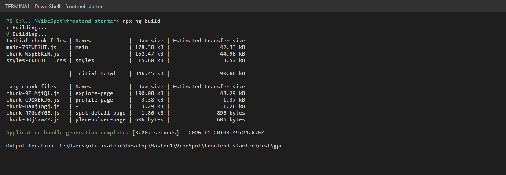

#### 8. Ce que je sais expliquer sans l'agent
`overrideComponent` remplace un composant enfant par une version vide, pour tester la page sans la carte. `setInput()` permet de donner une valeur aux `input()` d'un composant dans un test.
